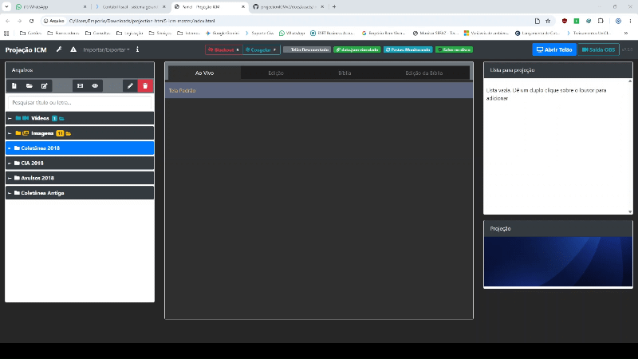

# Projeção ICM HTML5 `v2.2`

Sistema moderno, modular e completo de projeção e transmissão de louvores, textos bíblicos, avisos e mídias para cultos da **Igreja Cristã Maranata**.

Painel do Operador

---

## 🚀 Principais Recursos e Novidades (`v2.2`)

### 1. Controle Remoto pelo Celular via Wi-Fi (`server.js` + `controle.html`)
* **Conexão Rápida via QR Code e PIN:** Botão **Controle Wi-Fi** na barra superior exibe o QR Code offline, o endereço na rede local e um PIN numérico de 4 dígitos para acesso seguro a partir do navegador do celular conectado ao mesmo Wi-Fi.
* **Comunicação em Tempo Real (SSE):** Atualização instantânea entre o painel (`index.html`) e o dispositivo móvel via Server-Sent Events (`js/modules/remote.js` + `server.js`).
* **Controle Completo na Mão:**
  * Visualização do **slide atual**, **próximo slide** e status do Telão.
  * Navegação **Anterior / Próximo** e salto direto para qualquer estrofe da fila ativa.
  * Controles litúrgicos imediatos: **Blackout**, **Congelar** e **Tela Padrão**.
  * **Controle de Vídeos Remoto:** Play/Pause, `-10s`, `+10s`, barra de progresso e minutagem.
  * **Fila & Acervo:** Remoção de itens da fila e busca rápida para adicionar louvores, avisos e mídias direto pelo celular.
* **Inicialização Simplificada:** Script [`Iniciar_Com_Wifi.bat`](Iniciar_Com_Wifi.bat) pronto para Windows utilizando Node.js nativo sem dependências externas.

### 2. Aba Dedicada de Edição da Bíblia (`ACF` e `NVI`)
* **Editor Integrado (`js/bible.js`):** Aba **Edição da Bíblia** com seleção rápida por Versão (`ACF` / `NVI`), Livro e Capítulo, sincronizada automaticamente com a aba **Bíblia**.
* **Busca e Controle Granular:** Filtro instantâneo por número ou trecho do versículo (preservando versículos ocultos ao salvar), inserção de novo versículo e restauração individual ou de todo o capítulo para o texto original.
* **Persistência Leve e Exportação:** Salva somente as alterações em armazenamento local (`localStorage` + `MediaDB`), atualiza projeções bíblicas abertas em tempo real e permite exportar a base modificada em `.js`.

### 3. Controles de Vídeo ao Vivo, Sincronia e Congelamento Inteligente
* **Controles Inline de Vídeo:** Quando um vídeo está ativo na lista **Ao Vivo**, a própria linha exibe botões de **Play/Pause**, **Reiniciar**, **Retroceder 10s**, **Avançar 10s**, barra de progresso arrastável e minutagem (`MM:SS`).
* **Áudio Exclusivo no Telão e Sincronia:** A janela externa do Telão (`view.html`) e a pré-visualização permanecem sincronizadas no tempo de reprodução, mantendo a prévia sempre muda para evitar duplicidade ou eco na mesa de som.
* **Trava de Estado ao Minimizar/Restaurar:** Vídeos pausados pelo operador mantêm o estado de pausa mesmo se a janela do Telão for minimizada e restaurada.
* **Congelar Real (`[F]`):** Captura o último quadro exibido (imagens ou vídeos, incluindo fundos em movimento) respeitando o *aspect ratio* em tela cheia e **silencia imediatamente qualquer áudio de vídeo** enquanto permite ao operador preparar os próximos itens sem alterar o telão ao público.
* **Palco Fullscreen com Aspect Ratio:** Mídias e vídeos preenchem o telão respeitando proporcionalmente as dimensões da tela (`object-fit: contain`), sem cortes ou distorções.

### 4. Comunicação Nativa em Tempo Real (`BroadcastChannel`) & Saída OBS (`obs.html`)
* O painel (`index.html`), o telão externo (`view.html`), a saída transparente do OBS (`obs.html`) e a miniatura interna comunicam-se via `BroadcastChannel('projecao_icm_channel')` com monitor contínuo de conexão do Telão.
* **Saída OBS Lower Thirds:** Fundo 100% transparente em *glassmorphism* azul e dourado com badges contextuais (`LOUVOR`, `BÍBLIA`, `AVISO`), ocultamento automático em telas padrão/mídias e sincronia completa com **Blackout** e **Congelar**.

### 5. Pastas Automáticas (`videos/` e `imagens/`), Cache Offline e Mídias Sem Cópia
* **Pastas Automáticas Inteligentes:** Monitora pastas locais de vídeos e imagens com ordenação determinística, deduplicação por tipo e nome, preservação da seleção durante varreduras, cache offline em `IndexedDB` e reaproveitamento automático de permissões já concedidas.
* **Referenciamento Direto (Zero Cópia):** Mídias de vídeo (`.mp4`, `.avi`) e imagem (`.jpg`, `.jpeg`, `.png`, `.gif`, `.webp`) selecionadas do disco não inflam o JSON do acervo.
* **Enquadramento 16:9 e Visualizador:** Modal de recorte interativo em `1920x1080` para imagens de fundo (Zoom e Posição X/Y) e pré-visualização de fotos/vídeos antes de enviar ao telão.

### 6. Busca Inteligente, Bíblia Sob Demanda (*Lazy-Loading*) e Auto-Fit
* **Busca Fonética Normalizada:** Localiza louvores por título, número ou qualquer trecho da letra, além de avisos por título e conteúdo, ignorando acentos, cedilhas e pontuação.
* **Carga Bíblica Sob Demanda:** Bases `bible/acf.js` e `bible/nvi.js` carregadas somente ao utilizar recursos bíblicos, mantendo abertura ágil do painel.
* **Auto-Fit & Tipografia Litúrgica Uniforme:** Cálculo dinâmico contra a área útil para evitar cortes de texto e padronização de estrofes com `CORO`, `BIS`, `FINAL` e `REFRÃO`, preservando o slide atual mesmo durante edições no acervo.
* **Vínculo Direto com `data.json`:** Persistência física no arquivo local via File System Access API com indicadores discretos (`Salvo` / `Alterações não salvas`).

### 7. Arquitetura Modular (`js/modules/`)
* Código organizado em módulos especializados:
  * [`js/modules/storage.js`](js/modules/storage.js): IndexedDB (`MediaDB`) e File System Access API.
  * [`js/modules/media.js`](js/modules/media.js): Mídias, cache de pastas automáticas, recorte 16:9 e visualizador.
  * [`js/modules/projection.js`](js/modules/projection.js): `BroadcastChannel`, fila Ao Vivo, controles de vídeo, Blackout e Congelar.
  * [`js/modules/tree.js`](js/modules/tree.js): Árvore nativa de pastas, seleção e busca full-text.
  * [`js/modules/remote.js`](js/modules/remote.js): Ponte Wi-Fi SSE, catálogo remoto, despacho de comandos e QR Code offline.

---

## 🛠️ Tecnologias Utilizadas

* **HTML5 / CSS3 / JavaScript Moderno (ES6+)**
* **Node.js (Módulos Nativos `http`, `fs`, `path`, `os`, `crypto`):** Servidor local opcional e zero-dependências para o Controle Remoto Wi-Fi.
* **Server-Sent Events (SSE):** Sincronização em tempo real entre computador e celular na rede local.
* **Reveal.js:** Motor de apresentação e transições de slides.
* **Bootstrap 4 & jQuery 3.3.1:** Estrutura responsiva da interface.
* **FontAwesome 5:** Ícones vetoriais em toda a aplicação.
* **BroadcastChannel API:** Sincronização inter-janelas e streaming OBS.
* **IndexedDB API (`MediaDB`):** Armazenamento local de alta capacidade (mídias, pastas automáticas e edições bíblicas).
* **File System Access API:** Salvamento e sincronização direta de dados no disco local.

---

## 🖥️ Compatibilidade

* **Google Chrome** (Recomendado)
* **Microsoft Edge** (Recomendado)
* **Mozilla Firefox / Opera / Brave**
* **Node.js LTS** *(necessário apenas ao executar via `Iniciar_Com_Wifi.bat` / `server.js` para Controle Wi-Fi pelo celular)*

---

## 📖 Como Usar

### 1. Executável Desktop Windows (`ProjecaoICM.exe`) — Recomendado
1. Dê um duplo clique em [`ProjecaoICM.exe`](ProjecaoICM.exe) (com o ícone oficial da Igreja Cristã Maranata).
2. O aplicativo inicia automaticamente o servidor local embutido *(sem exigir instalação do Node.js)*, abre o Painel de Controle e o **Telão** (`view.html`), exibe o endereço e **PIN** para o Controle Wi-Fi no celular e minimiza para a bandeja do sistema.
3. O executável também funciona de forma **portátil e autônoma** caso seja copiado sozinho para outra pasta ou outro computador Windows (extrai automaticamente os recursos em `%LocalAppData%\ProjecaoICM\app`).

### 2. Modo Tradicional via Navegador ou Script Node.js
1. Abra o arquivo [`index.html`](index.html) no navegador na tela de controle do operador *(ou inicie via [`Iniciar_Com_Wifi.bat`](Iniciar_Com_Wifi.bat) usando o **[Node.js LTS](https://nodejs.org/dist/v26.13.0/node-v26.13.0-x64.msi)** para habilitar o controle pelo celular)*.
2. O sistema abrirá **automaticamente** a janela do Telão ([`view.html`](view.html)) ao iniciar *(caso o navegador bloqueie o pop-up automático na primeira execução, autorize pop-ups para o endereço ou clique em **Abrir Telão agora** no aviso exibido)*. Arraste a janela para o projetor/TV e pressione **F11** para tela cheia.
3. Para salvar alterações diretamente no arquivo físico, utilize **Vincular data.json** na barra superior.
4. No painel esquerdo, dê um **duplo clique** sobre qualquer hino, aviso ou mídia (ou selecione versículos nas abas **Bíblia** / **Edição da Bíblia**) para enviar à fila de projeção.
5. Na aba **Ao Vivo**, clique nos slides ou utilize as setas do teclado para conduzir o culto.

### 3. Controle Remoto pelo Celular no Wi-Fi
1. Inicie o sistema via [`ProjecaoICM.exe`](ProjecaoICM.exe) **ou** via [`Iniciar_Com_Wifi.bat`](Iniciar_Com_Wifi.bat) *(requer Node.js apenas no `.bat`)*.
2. O painel abrirá em `http://localhost:3000/index.html`. Clique no botão **Controle Wi-Fi** na barra superior (ou consulte a janela do `ProjecaoICM.exe`).
3. Conecte o celular na **mesma rede Wi-Fi** do computador e escaneie o **QR Code** (ou acesse a URL exibida e informe o **PIN de 4 dígitos**).
4. Pelo celular (`controle.html`), acompanhe os slides ao vivo, avance/retroceda estrofes, acione **Blackout**, **Congelar**, **Tela Padrão**, controle vídeos e adicione itens do acervo à fila.

### 4. Transmissão para OBS Studio / vMix (Lower Thirds)
1. No painel principal, clique em **Saída OBS** ou adicione uma fonte do tipo **Navegador** (*Browser Source*) no OBS Studio apontando para [`obs.html`](obs.html) (`http://localhost:3000/obs.html` quando usando o servidor Wi-Fi ou `file:///.../obs.html` no modo direto).
2. Configure **Largura:** `1920` e **Altura:** `1080`.
3. As letras dos louvores, avisos e versículos aparecerão automaticamente no terço inferior com fundo transparente sobre a câmera.

---

## ⌨️ Tabela de Atalhos do Operador

Atalho | Ação
:---:|:---
`B` ou `ESC` | **Blackout Instantâneo** (escurece/exibe o telão mantendo o slide posicionado)
`F` | **Congelar (Freeze)** (trava a última imagem/quadro no telão e silencia vídeos)
`▲` / `◄` | Estrofe ou slide anterior
`▼` / `►` | Próxima estrofe ou slide
`Ctrl + S` | Salva o louvor em edição (quando na aba **Editar**)

---

## 👤 Autoria e Manutenção

### Manutenedores do Projeto (`v2.2`)
* **ICM — Leopoldina / MG**
  * **Caio Monteiro**
    * **E-mail:** [caiormleo@outlook.com.br](mailto:caiormleo@outlook.com.br)
    * **GitHub:** [@chacalbl4ck](https://github.com/chacalbl4ck)
  * **André Castilho**
    * **E-mail:** [atendimento@amcast.com.br](mailto:atendimento@amcast.com.br)

### Desenvolvimento Original
* **Desenvolvido originalmente por:** Ítalo Carvalho Zaina
* **Revisores originais:** Ítalo, Sinvaldo, Geff
