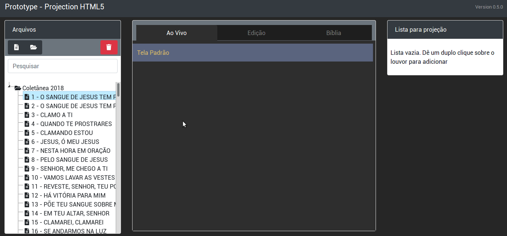
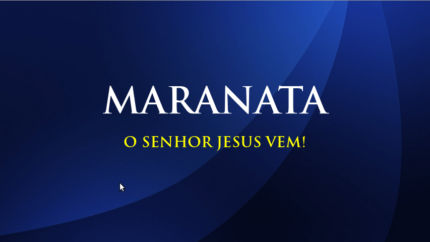

# Projeção ICM HTML5 `v2.0.0`

Sistema moderno, leve e completo de projeção e transmissão de louvores, textos bíblicos e avisos para cultos da **Igreja Cristã Maranata**.

Painel do Operador | Janela de Projeção (Telão)
:-------------------------:|:-------------------------:
 | 

---

## 🚀 Principais Recursos e Novidades da Versão 2.0.0

### 1. Comunicação Nativa em Tempo Real (`BroadcastChannel`)
* Elimina a dependência frágil de pop-ups e janelas-filhas.
* O painel (`index.html`), o telão externo (`view.html`), a saída de transmissão (`obs.html`) e a miniatura interna comunicam-se instantaneamente em tempo real através da API nativa `BroadcastChannel('projecao_icm_channel')`.
* Monitoramento automático de status do telão com indicador visual no cabeçalho (*Telão Conectado / Desconectado*).

### 2. Controles de Culto Instantâneos (Atalhos de Teclado)
* **`[B]` Blackout Instantâneo:** Apaga a tela do projetor imediatamente mantendo o slide atual pré-posicionado. Ao desativar, a imagem retorna suavemente.
* **`[F]` Congelar (Freeze):** Trava o telão no slide atual enquanto o operador navega na lista "Ao Vivo", pesquisa outros hinos ou prepara o próximo louvor sem que o público veja as trocas.
* **Navegação rápida:** Setas direcionais `[▲]` / `[▼]` / `[◄]` / `[►]` para avançar e retroceder estrofes, e `[ESC]` para retornar imediatamente à Tela Padrão.

### 3. Saída Transparente para OBS Studio e Streaming (`obs.html`)
* Janela dedicada com fundo 100% transparente (`background: transparent !important`).
* Renderização em **Lower Thirds** (terço inferior da tela) com design em *glassmorphism* azul e dourado de alta legibilidade para sobreposição em câmeras de transmissão ao vivo.
* Badges dinâmicos contextuais para cada tipo de conteúdo: `LOUVOR`, `BÍBLIA` ou `AVISO`.
* Ocultamento automático e suave durante telas padrão ou mídias em tela cheia.
* Sincronização automática com os atalhos de Blackout e Freeze.
* Botão de acesso rápido **Saída OBS** na barra superior do painel.

### 4. Busca Inteligente e Tolerante a Erros
* Normalização fonética e ortográfica: desconsidera completamente acentos (ex: `é`, `ã`, `õ`), cedilhas (`ç`), vírgulas, pontos e parênteses.
* Busca simultânea pelo título, número do hino ou por qualquer trecho/estrofe da letra.
* Localiza também avisos pelo título de identificação e pelo texto do corpo.
* Inicialização limpa: todas as pastas iniciam recolhidas; ao pesquisar, apenas as pastas com correspondências encontradas se abrem automaticamente.

### 5. Fundos Dinâmicos: Imagens, Vídeos e Enquadramento 16:9
* **Suporte a Vídeos de Fundo:** Suporta arquivos `.mp4` e `.avi` (até 30 segundos e 10 MB), reproduzidos em loop contínuo e silencioso com o texto do hino mantido em primeiro plano.
* **Suporte a Imagens de Fundo:** Suporta formatos `.jpg`, `.jpeg`, `.png`, `.gif` e `.webp`.
* **Ferramenta de Enquadramento 16:9:** Modal interativo que identifica imagens fora da proporção 16:9, permitindo ao operador regular Zoom (100% a 250%), Posição X e Posição Y em tempo real com exportação Full HD (1920x1080).
* **Motor Reveal.js Atualizado:** Suporte nativo corrigido para renderizar mídias locais e *Data URLs* sem quebrar ou apresentar tela em branco.

### 6. Otimização Bíblica e Carregamento Sob Demanda (*Lazy-Loading*)
* Remoção dos scripts estáticos pesados `bible/acf.js` (~4.4 MB) e `bible/nvi.js` (~4.2 MB) do carregamento inicial da página.
* **Economia de mais de 8.6 MB de processamento bloqueante no startup**, garantindo inicialização quase instantânea do painel.
* As bases bíblicas (ACF e NVI) são carregadas em segundo plano sob demanda com indicador visual assim que o operador clica pela primeira vez na aba "Bíblia".

### 7. Reprodução de Vídeos do YouTube por Link ao Telão
* **Adição Rápida via Link:** Adicione vídeos do YouTube diretamente à árvore de mídias através do botão com o ícone do YouTube na barra de ferramentas.
* **Compatibilidade Completa:** Reconhece links normais (`youtube.com/watch?v=...`), links de compartilhamento encurtados (`youtu.be/...`), YouTube Shorts (`youtube.com/shorts/...`), tags de incorporação (`embed`) ou apenas o código ID de 11 caracteres.
* **Pré-visualização Inteligente:** Exibe a miniatura oficial em alta resolução e preenche automaticamente o título do vídeo via serviço oEmbed.
* **Barra de Controle Completa e Interativa no Painel:**
  * **Play / Pause** com alternância visual do botão.
  * **Barra de Progresso (Seek Bar):** Permite navegar interativamente para qualquer ponto do vídeo arrastando a barra.
  * **Tempo e Duração:** Marcador digital com tempo decorrido e tempo total (`00:00 / 00:00`).
  * **Retrocesso e Avanço Rápido:** Botões dedicados de **-10 segundos** e **+10 segundos**.
  * **Controle de Volume e Mudo:** Slider de volume (0 a 100%) e botão de alternância rápida de Mudo.
* **Prevenção de Áudio Duplicado:** O iframe de miniatura do operador permanece automaticamente mudo, enquanto o telão externo reproduz o áudio na intensidade regulada pelo operador.
* **Integração com OBS Studio:** Durante a exibição do vídeo, os Lower Thirds são recolhidos automaticamente para manter a transmissão de vídeo limpa.

### 8. Gerenciamento Completo de Pastas, Mídias e Avisos
* **Renomear Pastas:** Permite renomear qualquer pasta personalizada criada pelo operador através do botão <i class="fas fa-edit"></i> na barra de ferramentas.
* **Visualizador de Mídias e YouTube:** Permite inspecionar imagens em alta resolução, reproduzir vídeos locais e pré-visualizar vídeos do YouTube com player embutido antes de projetar.
* **Edição de Avisos com Seleção de Pastas:** Permite editar avisos já criados (nome, título e texto) e organizá-los na Pasta Geral ou em qualquer pasta personalizada.
* **Banco Local IndexedDB (`MediaDB`):** Armazenamento de alta capacidade para evitar estouro da cota do `localStorage`.
* **Interface Polida com Ícones Verificados:** Todos os ícones do sistema foram padronizados para o FontAwesome 5 oficial sem erros de renderização (`[! ?]`).

---

## 🛠️ Tecnologias Utilizadas

* **HTML5 / CSS3 / JavaScript Moderno (ES6+)**
* **Reveal.js:** Motor de apresentação e transições de slides.
* **Bootstrap 4 & jQuery 3.3.1:** Estrutura responsiva da interface.
* **FontAwesome 5:** Ícones vetoriais em toda a aplicação.
* **BroadcastChannel API:** Sincronização inter-janelas e streaming.
* **IndexedDB API (`MediaDB`):** Armazenamento local de mídias de alta resolução.
* **Perfect Scrollbar:** Rolagem fluida no painel de estrofes ao vivo.

---

## 🖥️ Compatibilidade

* **Google Chrome** (Recomendado)
* **Microsoft Edge** (Recomendado)
* **Mozilla Firefox**
* **Opera / Brave**

O sistema funciona diretamente no navegador, sem necessidade de servidores externos obrigatórios, NodeJS ou instalação de dependências pesadas.

---

## 📖 Como Usar

### 1. Projeção no Templo (Painel + Telão)
1. Para a melhor experiência e liberação completa de reprodução do YouTube sem restrições de segurança do navegador, execute o arquivo [`iniciar_sistema.bat`](iniciar_sistema.bat) ou abra o arquivo [`index.html`](index.html) no navegador em sua tela de controle (monitor do operador).
2. O sistema abrirá automaticamente a janela do telão ([`view.html`](view.html)). Arraste a janela do telão para a tela estendida (projetor/TV) e pressione **F11** para tela cheia.
3. No painel de arquivos à esquerda, dê um **duplo clique** sobre qualquer hino, aviso ou mídia para adicionar à lista de projeção.
4. Na aba **"Ao Vivo"**, clique na estrofe desejada ou navegue utilizando as setas do teclado.

### 2. Transmissão para OBS Studio / vMix (Lower Thirds)
1. No painel principal, clique no botão **"Saída OBS"** na barra superior ou acesse o arquivo [`obs.html`](obs.html).
2. No **OBS Studio**, adicione uma nova fonte do tipo **Navegador** (*Browser Source*):
   * **URL:** Caminho local do arquivo `obs.html` (ex: `http://localhost/.../obs.html` ou `file:///.../obs.html`).
   * **Largura:** `1920`
   * **Altura:** `1080`
3. As letras dos louvores e versículos bíblicos aparecerão automaticamente no terço inferior com fundo transparente sobre a câmera da igreja.

---

## ⌨️ Tabela de Atalhos do Operador

Atalho | Ação
:---:|:---
`B` | **Blackout Instantâneo** (apaga/acende o telão imediatamente)
`F` | **Congelar (Freeze)** (trava o telão enquanto prepara o próximo hino)
`▲` / `◄` | Estrofe anterior
`▼` / `►` | Próxima estrofe
`ESC` | Retorna imediatamente para a Tela Padrão
`Ctrl + S` | Salva o louvor em edição (aba Editar)

---

## 👤 Autoria e Manutenção

### Manutenedores do Projeto (v2.0.0)
* **ICM — Leopoldina / MG**
  * **Caio Monteiro**
    * **E-mail:** [caiormleo@outlook.com.br](mailto:caiormleo@outlook.com.br)
    * **GitHub:** [@chacalbl4ck](https://github.com/chacalbl4ck)
  * **André Castilho**
    * **E-mail:** [atendimento@amcast.com.br](mailto:atendimento@amcast.com.br)

### Desenvolvimento Original
* **Desenvolvido originalmente por:** Ítalo Carvalho Zaina
* **Revisores originais:** Ítalo, Sinvaldo, Geff
