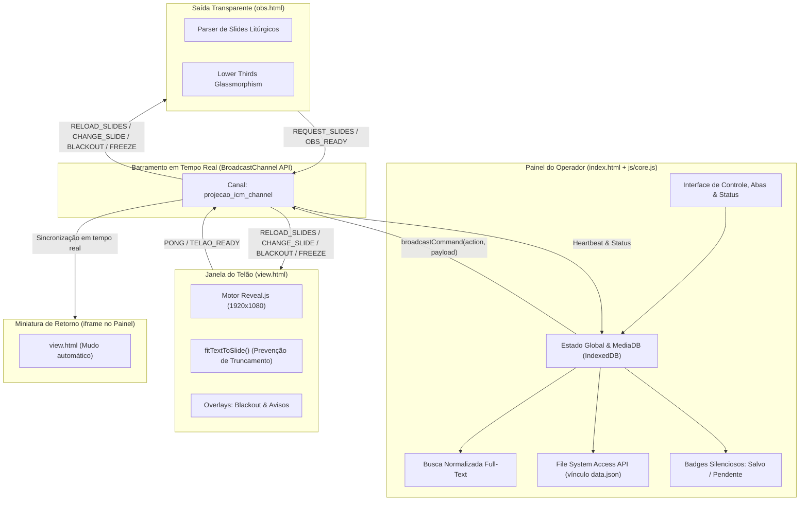
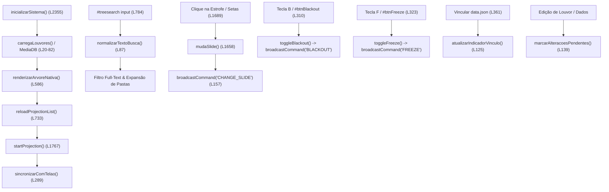

# Relatório de Engenharia Reversa & Especificação Técnica de Melhorias
## Sistema: Projeção ICM HTML5 v2.1.0 (`projectionICMv2`)

---

## 1. Identificação e Metadados do Projeto

| Parâmetro | Detalhe |
| :--- | :--- |
| **Nome do Software** | Projeção ICM HTML5 (Versão 2.1.0 Consolidada) |
| **Repositório Git** | `https://github.com/chacalbl4ck/projectionICMv2.git` |
| **Autor Original** | Ítalo Carvalho Zaina (*Revisores originais: Sinvaldo, Geff*) |
| **Manutenção & Evolução (v2.0.0 / v2.1.0)** | **ICM — Leopoldina / MG**<br>• Caio Monteiro ([caiormleo@outlook.com.br](mailto:caiormleo@outlook.com.br) / [@chacalbl4ck](https://github.com/chacalbl4ck))<br>• André Castilho ([atendimento@amcast.com.br](mailto:atendimento@amcast.com.br)) |
| **Branch / Versão Analisada** | `main` (Versão 2.1.0 — Ciclo de Estabilidade, Auto-Fit de Viewport e Faxina de Dependências) |
| **Tecnologias Base** | HTML5 Semântico, CSS3 Flexbox/Grid, JavaScript Moderno (ES6+), BroadcastChannel API, IndexedDB API (`MediaDB`), File System Access API nativa, jQuery 3.3.1, Bootstrap 4, Reveal.js 3.6.0+, FontAwesome 5 (SVG & WebFonts) |
| **Domínio da Aplicação** | Projeção e transmissão litúrgica multimídia para cultos da Igreja Cristã Maranata (Louvores, Bíblias ACF/NVI sob demanda, Avisos, Mídias Locais de Imagem/Vídeo e Lower Thirds transparentes para OBS Studio/vMix) |
| **Ambiente de Execução** | Navegadores Web modernos (Google Chrome, Microsoft Edge, Mozilla Firefox, Opera, Brave) com inicialização direta via navegador e sincronização local sem dependência de scripts em lote ou servidores de desenvolvimento externos |
| **Política de Conteúdo** | **Projeto de uso litúrgico/interno:** o acervo integral de louvores ([`data/data.json`](file:///c:/Users/Emporio/Downloads/projection-html5-icm-master/data/data.json) com ~1,90 MB) e as versões bíblicas completas ([`bible/acf.js`](file:///c:/Users/Emporio/Downloads/projection-html5-icm-master/bible/acf.js) e [`bible/nvi.js`](file:///c:/Users/Emporio/Downloads/projection-html5-icm-master/bible/nvi.js) totalizando ~8,05 MB) são ativos essenciais permanentes e **permanecem 100% preservados e operacionais no projeto**. |

---

## 2. Inventário Completo de Arquivos e Componentes

A estrutura física consolidada do repositório conta atualmente com **85 arquivos** totalizando aproximadamente **17,2 MB** (após a remoção da função do YouTube, eliminação do script `iniciar_sistema.bat` e faxina das bibliotecas órfãs `head.min.js`, `perfect-scrollbar.min.js` e `bootstrap.css` descompactado), distribuídos conforme a árvore oficial:

```
projection-html5-icm-master/
├── index.html                        <-- Painel de Controle Principal do Operador (738 linhas, ~42 KB)
├── view.html                         <-- Interface de Apresentação / Telão do Templo com Auto-Fit (334 linhas, ~14 KB)
├── obs.html                          <-- Saída Transparente para OBS Studio / Streaming (371 linhas, ~12 KB)
├── README.md                         <-- Guia oficial de recursos, atalhos e operação
├── RELATORIO_ENGENHARIA_REVERSA.md   <-- [Este Documento Técnico de Arquitetura e Engenharia Reversa]
├── GUIA_INTERNACIONALIZACAO.md       <-- Documentação técnica para reativação de multi-idiomas
├── bible/                            <-- Bases de dados bíblicos integrais em matrizes JavaScript
│   ├── acf.js                        <-- Almeida Corrigida Fiel (~4,02 MB - 31.102 versículos)
│   └── nvi.js                        <-- Nova Versão Internacional (~4,03 MB - 31.102 versículos)
├── css/                              <-- Folhas de estilo da aplicação
│   ├── bootstrap.min.css             <-- Bootstrap v4 framework base (~145 KB)
│   ├── bootstrap-grid.min.css        <-- Sistema de grid flexbox Bootstrap (~34 KB)
│   ├── bootstrap-reboot.min.css      <-- Reset e normalização CSS (~4 KB)
│   ├── fa-svg-with-js.css            <-- Estilos de suporte a ícones FontAwesome SVG (~7 KB)
│   ├── perfect-scrollbar.css         <-- Estilos de barra de rolagem estilizada (~2,4 KB)
│   ├── reveal.css                    <-- Motor Reveal.js de apresentação de slides (~58 KB)
│   ├── style.css                     <-- Estilos customizados do Painel do Operador (~11 KB)
│   ├── view.css                      <-- Estilos tipográficos do Telão, chaves musicais e responsividade (~9 KB)
│   └── theme/                        <-- Temas Reveal.js (icm.css, ceia.css e fontes SCSS)
├── data/
│   └── data.json                     <-- Banco de dados estruturado de louvores da ICM (~1,90 MB)
├── docs/                             <-- Manuais de usuário, documentação Jekyll e assets de suporte
│   ├── index.md                      <-- Portal Jekyll de documentação
│   ├── manual.md / manual.pdf        <-- Manual de operação em texto e formato PDF (~138 KB)
│   ├── coletanea-2018.md             <-- Catálogo hinológico de referência
│   ├── coletanea-antiga.md           <-- Acervo histórico de hinos
│   ├── cia-2018.md / avulsos-2018.md <-- Hinos de crianças, intermediários, adolescentes e avulsos
│   ├── ENGENHARIA_REVERSA.md         <-- Cópia oficial deste relatório de engenharia reversa
│   ├── GUIA_INTERNACIONALIZACAO.md   <-- Guia oficial de internacionalização
│   └── assets/                       <-- Mídias e GIFs demonstrativos (painel.gif, projecao.gif)
├── fontes/                           <-- Tipografias litúrgicas e pacote de ícones vetoriais
│   ├── fonts.css                     <-- Declarações @font-face
│   ├── Futura_Extra_Black_BT.ttf     <-- Tipografia principal dos louvores no telão (~39 KB)
│   ├── TrajanPro-Regular.ttf         <-- Tipografia dos títulos institucionais ("Maranata") (~403 KB)
│   ├── Jester.ttf / scriptmt.ttf     <-- Fontes cursivas complementares
│   └── icm.ttf / .woff / .svg / .eot <-- Pacote oficial de glifos e símbolos litúrgicos da ICM
├── imagens/                          <-- Imagens de fundo, marcas d'água e chaves musicais de repetição
│   ├── fundo.jpg / madeira_bg.jpg    <-- Fundos estáticos padrão (~47 KB e ~69 KB)
│   ├── campo-uva.jpg                 <-- Fundo especial para Santa Ceia (~924 KB)
│   ├── fundo-comunicado.png          <-- Arte padrão para avisos e comunicados da igreja
│   └── chaves-*.png                  <-- Chaves gráficas de repetição musical (BIS, 2x até 6x normais e small)
└── js/                               <-- Bibliotecas e lógica funcional do sistema
    ├── core.js                       <-- Orquestrador de ciclo de vida, editor e atalhos (~370 linhas)
    ├── modules/                      <-- Arquitetura Modular de Domínios
    │   ├── storage.js                <-- Persistência, IndexedDB e File System Access API (~190 linhas)
    │   ├── media.js                  <-- Mídias, Blobs tipados, varredura adaptativa e visualizador (~520 linhas)
    │   ├── projection.js             <-- Projeção, BroadcastChannel, slides Reveal.js e fundos (~450 linhas)
    │   └── tree.js                   <-- Árvore nativa de arquivos, busca full-text e pastas (~410 linhas)
    ├── bible.js                      <-- Controlador bíblico com lazy-loading assíncrono (202 linhas, ~9 KB)
    ├── reveal.js                     <-- Motor de projeção e transição de slides Reveal.js (~157 KB)
    ├── jquery-3.3.1.min.js           <-- Framework jQuery v3.3.1 (~87 KB)
    ├── popper.min.js                 <-- Utilitário de posicionamento Bootstrap (~19 KB)
    ├── bootstrap.min.js              <-- Componentes interativos Bootstrap v4 (~49 KB)
    ├── fontawesome-all.min.js        <-- Acervo completo de ícones FontAwesome 5 (~672 KB)
    ├── perfect-scrollbar.js          <-- Rolagem sincronizada de alta precisão (~35 KB)
    └── jquery.selection.js           <-- Utilitário de inserção rápida de tags no editor (~13 KB)
```

---

## 3. Engenharia Reversa Detalhada dos Módulos



---

### 3.1. Painel de Controle Principal ([`index.html`](file:///c:/Users/Emporio/Downloads/projection-html5-icm-master/index.html) — 738 linhas)

O `index.html` centraliza a operação e o controle litúrgico. Na versão 2.1.0, foram removidos todos os componentes do YouTube, eliminadas janelas intrusivas de alerta e implementado um fluxo visual moderno de persistência física em disco:

#### 1. Barra de Navegação Superior (`<nav class="navbar">`):
* **Configurações Litúrgicas (`#btnAbrirConf`):** Controle de temas (padrão ICM e Santa Ceia), tamanhos de fonte responsivos (`fontSizeRange` de 1vw a 4vw), imagens/vídeos de fundo e alternância de texto padrão (*"Maranata | O Senhor Jesus Vem"*).
* **Criação de Avisos Rápidos (`#btnCreateWarn`):** Aciona o modal `#newWarningModal` permitindo definir nome de identificação, texto e pasta de armazenamento.
* **Dropdown Importar/Exportar:**
  * `#linkFile`: Conexão direta bidirecional com o arquivo físico local via **File System Access API** com sincronização sob demanda.
  * `#import` e `#export`: Métodos tradicionais legados via upload de arquivo e download de blob `data.json`.
* **Badges de Vínculo e Salvamento:**
  * `#fileHandleStatus`: Indica se o arquivo `data.json` físico do disco está vinculado (`<i class="fas fa-link"></i> Vinculado`) ou não (`<i class="fas fa-unlink"></i> Não vinculado`).
  * `#statusSalvar`: Substitui antigos pop-ups invasivos. Exibe um indicador discreto em tempo real: círculo verde com check (`Salvo`) quando não há pendências, ou bolinha amarela pulsante (`Alterações não salvas`) ao modificar dados.
* **Controles Litúrgicos de Culto em Tempo Real:**
  * `#btnBlackout` (Atalho <kbd>B</kbd>): Apaga o telão instantaneamente sem desposicionar a estrofe atual. Acompanhado pelo alerta visual `#alertBlackoutActive`.
  * `#btnFreeze` (Atalho <kbd>F</kbd>): Congela a exibição externa, permitindo ao operador navegar livremente na lista e preparar novos louvores sem exibir trocas ao público. Acompanhado pelo alerta visual `#alertFreezeActive`.
* **Monitor de Conexão do Telão:** Badge dinâmico `#telaoStatusBadge` com ícone de status `#telaoStatusIcon` que monitora a conexão ativa com o telão via heartbeat periódico do `BroadcastChannel`.
* **Lançadores de Saída:**
  * `#btnLaunchView`: Abre a janela externa de projeção ([`view.html`](file:///c:/Users/Emporio/Downloads/projection-html5-icm-master/view.html)).
  * `#btnLaunchObs`: Abre a saída transparente para OBS Studio ([`obs.html`](file:///c:/Users/Emporio/Downloads/projection-html5-icm-master/obs.html)).

#### 2. Banner de Aviso de Vínculo (`#bannerVincularData`):
* Exibido logo abaixo da barra superior quando o sistema detecta que o operador está trabalhando na memória volátil (`fileHandle == null`).
* Alerta de forma pedagógica que as edições não serão gravadas no arquivo `data.json` da máquina a menos que o arquivo seja vinculado via botão integrado `#btnVincularDataBanner`.

#### 3. Coluna Esquerda — Árvore de Diretórios e Mídias (`col-3`):
* **Barra de Ferramentas:**
  * `#newSong`: Adicionar nova música em pasta selecionada com abertura automática do `<details>`, foco no campo de título e seleção imediata na interface.
  * `#newFolder`: Criar nova pasta personalizada.
  * `#btnRenameFolder`: Renomear qualquer pasta personalizada criada pelo usuário.
  * `#newImage`: Adicionar mídias locais nos formatos homologados (`MP4`, `AVI`, `JPG`, `JPEG`, `PNG`, `GIF`, `WEBP`), sem limite de tamanho (MB) ou duração (s).
  * `#btnPreviewMedia`: Visualizar imagens em alta resolução e reproduzir vídeos locais em modal antes de enviar à projeção.
  * `#btnEditWarning`: Editar avisos já cadastrados e reorganizá-los entre pastas.
  * `#deleteFromTree`: Exclusão segura de itens ou pastas inteiras com diálogo de confirmação.
* **Campo de Busca Full-Text (`#treesearch`):** Busca instantânea com tolerância fonética que filtra simultaneamente por título do louvor, número, qualquer estrofe da letra ou conteúdo de avisos.

#### 4. Coluna Central — Área de Trabalho Multimodal (`col-6`):
* **Aba "Ao Vivo" (`#live`):**
  * Tabela de Estrofes (`#livesongs`): Renderiza as estrofes do louvor ativo com destaque da linha em projeção (`.active`), rolagem fluida e navegação rápida por clique ou setas direcionais. A barra do YouTube foi totalmente eliminada.
* **Aba "Edição" (`#edit`):** Editor de louvores com injeção ágil de notações hinológicas:
  * Marcadores de repetição: `BIS` (grande), `BIS (P)` (pequena), `2x` até `6x`.
  * Marcadores de seção: `CORO` (amarelo), `FINAL` (vermelho), `Contracanto` (verde itálico) e tags customizadas.
  * Indicador de salvamento local `#statusSalvarEditor` ao lado do botão `#save`.
* **Aba "Bíblia" (`#bible`):** Interface bíblica otimizada com lazy-loading:
  * Indicador de carregamento `#bibleLoadingIndicator` exibido enquanto as matrizes textuais são baixadas sob demanda.
  * Seletor de versão (ACF ou NVI).
  * Navegação colunar contínua: Testamento -> Livro -> Capítulo -> Versículo Inicial -> Versículo Final com painel de pré-visualização.

#### 5. Coluna Direita — Fila de Projeção e Miniatura (`col-3`):
* **Fila de Projeção (`#projections`):** Tabela com os itens preparados para o culto (louvores, versículos, imagens, vídeos e avisos) com remoção unitária e ativação por clique. A antiga notificação invasiva `#msgSave` foi completamente removida.
* **Miniatura de Retorno do Operador (`#iframeProjection`):** Incorpora `view.html` com flags de segurança e modo mudo automático, permitindo ao operador monitorar visualmente o telão em tempo real.

#### 6. Modais Especializados:
* `#cropAdjustModal`: Ferramenta interativa de enquadramento 16:9 com canvas em tempo real, detecção de proporção, controle de Zoom (100% a 250%) e Pan X/Y.
* `#mediaViewerModal`: Player de pré-visualização de imagem e vídeo local antes da exibição pública.
* `#renameFolderModal`: Modal com persistência para renomeação de pastas.
* `#excluirModal`: Confirmação segura de exclusão de louvores ou pastas.

---

### 3.2. Núcleo Lógico e de Estado ([`js/core.js`](file:///c:/Users/Emporio/Downloads/projection-html5-icm-master/js/core.js) — 2.428 linhas)

O `js/core.js` centraliza o estado reativo da aplicação, coordena o barramento de eventos, executa a compilação HTML dos slides e manipula a persistência de dados.

#### A. Tabela Consolidada de Variáveis de Estado Global
| Variável | Tipo | Finalidade Litúrgica e Funcional |
| :--- | :--- | :--- |
| `dados` | `Array<Object>` | Árvore hierárquica em memória contendo pastas, louvores, mídias e avisos. |
| `projecao` | `Array<Object>` | Fila ordenada de itens ativos da projeção (`s`=louvor, `b`=bíblia, `i`=imagem/vídeo, `w`=aviso). |
| `imagens` | `Array<Object>` | Lista de mídias cadastradas na pasta geral (`{name, image, type}`). |
| `avisos` | `Array<Object>` | Lista de avisos formatados da pasta geral (`{name, warning}`). |
| `pastaAtiva` / `louvorAtivo` | `Number` | Índices apontadores da pasta e do louvor selecionados na árvore. |
| `projecaoAtiva` | `Number` | Índice absoluto do slide/estrofe atualmente em exibição pública (preservado continuamente durante edições). |
| `windowView` | `Window \| null` | Referência à janela pop-up externa aberta do telão. |
| `iframeView` | `Window` | Referência ao `contentWindow` da miniatura interna do painel. |
| `viewSlides` | `String` | Buffer HTML contendo todas as seções `<section>` geradas para o Reveal.js. |
| `configuracoes` | `Object` | Configurações globais persistidas (temas, fontes, fundos e tela padrão). |
| `fileHandle` | `FileSystemFileHandle` | Permissão concedida pelo operador para escrita contínua em disco via File System Access API. |
| `temAlteracoesPendentes` | `Boolean` | Flag booleana que controla se há modificações em memória pendentes de gravação física. |
| `MediaDB` | `Object` | Singleton de interface assíncrona com `IndexedDB` (`ProjecaoICM_DB`) para mídias pesadas. |
| `projectionBroadcast` | `BroadcastChannel` | Instância nativa do canal `'projecao_icm_channel'` para comunicação inter-janelas. |
| `isBlackout` | `Boolean` | Estado atual do Blackout (telão apagado/aceso). |
| `isFrozen` | `Boolean` | Estado atual do Freeze (congelamento de transmissão de slides). |
| `telaoConnected` | `Boolean` | Status real da conexão com a janela externa do telão. |
| `lastTelaoPong` | `Number` | Timestamp do último handshake recebido da janela externa. |
| `popupBloqueado` | `Boolean` | Flag de detecção de bloqueador de pop-up do navegador. |
| `currentCropImage` | `HTMLImageElement` | Objeto de imagem em memória durante ajuste no modal de enquadramento 16:9. |

#### B. Mapeamento de Funções do `core.js` (Com Linhas Exatas do Código)



* **Vínculo Físico e Monitor de Alterações Pendentes:**
  * `atualizarIndicadorVinculo()` ([L125–137](file:///c:/Users/Emporio/Downloads/projection-html5-icm-master/js/core.js#L125-L137)): Atualiza o badge `#fileHandleStatus` e exibe/oculta o banner `#bannerVincularData`.
  * `marcarAlteracoesPendentes(temPendencias)` ([L139–155](file:///c:/Users/Emporio/Downloads/projection-html5-icm-master/js/core.js#L139-L155)): Altera o badge `#statusSalvar` e `#statusSalvarEditor` para ícone amarelo (pendente) ou verde (salvo).
* **Barramento de Comunicação em Tempo Real:**
  * `broadcastCommand(action, payload)` ([L157–187](file:///c:/Users/Emporio/Downloads/projection-html5-icm-master/js/core.js#L157-L187)): Envia mensagens simultaneamente via `BroadcastChannel`, `windowView.postMessage` e `iframeView.postMessage`.
  * `projectionBroadcast.onmessage` ([L191–211](file:///c:/Users/Emporio/Downloads/projection-html5-icm-master/js/core.js#L191-L211)): Escuta eventos (`TELAO_READY`, `PONG`, `REQUEST_SLIDES`, `OBS_READY`).
  * Supervisor de Conexão ([L226–255](file:///c:/Users/Emporio/Downloads/projection-html5-icm-master/js/core.js#L226-L255)): Heartbeat a cada 1.200ms com verificação de status.
  * `sincronizarComTelao()` ([L289–308](file:///c:/Users/Emporio/Downloads/projection-html5-icm-master/js/core.js#L289-L308)): Transmite tema ativo, tamanho de fonte, slides compilados e estrofe selecionada mantendo a posição pública.
* **File System Access API & Gravação Física em Disco:**
  * `$("#linkFile").click()` e `$("#btnVincularDataBanner").click()` ([L361–416](file:///c:/Users/Emporio/Downloads/projection-html5-icm-master/js/core.js#L361-L416)): Conecta diretamente ao arquivo `data.json` através de `window.showOpenFilePicker`.
  * `salvarDiretoNoDisco()` ([L418–434](file:///c:/Users/Emporio/Downloads/projection-html5-icm-master/js/core.js#L418-L434)): Grava no arquivo local usando `fileHandle.createWritable()` e limpa o indicador de pendências (`marcarAlteracoesPendentes(false)`).
* **Correção na Adição de Louvores (`$('#listaDePastas > a')` - [L891–923](file:///c:/Users/Emporio/Downloads/projection-html5-icm-master/js/core.js#L891-L923)):**
  * Cria o objeto no array `dados[pasta].songs`, vincula imediatamente `pastaAtiva` e `louvorAtivo`, renderiza a árvore com a pasta recém-modificada forçada como aberta (`open = true`), rola a visão suavemente até o item novo, seleciona visualmente e transfere o foco do cursor para o formulário de edição `#title`.
* **Cálculo Uniforme de Fontes Hinológicas (`generateLiveList` - [L1502–1630](file:///c:/Users/Emporio/Downloads/projection-html5-icm-master/js/core.js#L1502-L1630)):**
  * Elimina tags HTML (`<font>`, `<blockquote>`, `<i>`, `<br>`) e rótulos de marcação litúrgica (`CORO`, `FINAL`, `REFRÃO`) antes de calcular `charCount` e a contagem de linhas visíveis reais.
  * Evita que estrofes com inserções recebam fontes menores do que estrofes limpas. Envolve o conteúdo em contêineres `.verse-container` e `.verse-text` para auto-dimensionamento.
* **Preservação de Projeção Durante Edição:**
  * `generateLiveList()` não mais força `projecaoAtiva = 0`.
  * Ao salvar um hino na aba Edição (`#save.click` - [L1000–1035](file:///c:/Users/Emporio/Downloads/projection-html5-icm-master/js/core.js#L1000-L1035)), a projeção ao vivo só é regerada se a música editada for a que está atualmente projetada, preservando exatamente o índice do slide ativo via `updateViewSlides()`.

---

### 3.3. Janela de Apresentação e Telão ([`view.html`](file:///c:/Users/Emporio/Downloads/projection-html5-icm-master/view.html) — 334 linhas)

O arquivo `view.html` é a interface de projeção pública exibida no projetor ou TV do templo:

* **Eliminação Completa do YouTube:**
  * Remoção do container `#ytPlayerWrapper`, do iframe do YouTube, das rotinas de controle da API e da tag de script externa `https://www.youtube.com/iframe_api`.
  * Código 100% autônomo e offline, sem dependência de conexões de terceiros.
* **Configuração Robusta do Reveal.js ([L32–44](file:///c:/Users/Emporio/Downloads/projection-html5-icm-master/view.html#L32-L44)):**
  ```javascript
  Reveal.initialize({
    controls: false,
    progress: false,
    history: false,
    keyboard: true,
    center: true,
    transition: 'fade',
    width: 1920,
    height: 1080,
    margin: 0.03,
    minScale: 0.1,
    maxScale: 2.5
  });
  ```
* **Algoritmo de Auto-Ajuste de Viewport (`fitTextToSlide` - [L46–95](file:///c:/Users/Emporio/Downloads/projection-html5-icm-master/view.html#L46-L95)):**
  * Monitora continuamente os slides ativos e os eventos `slidechanged`, `resize` e `ready`.
  * Verifica se a altura do texto (`scrollHeight`) ultrapassa `78vh` ou se a largura (`scrollWidth`) ultrapassa `94vw`.
  * Caso detecte risco de corte ou transbordamento, reduz progressivamente o multiplicador de escala em passos finos até que todo o texto caiba perfeitamente no espaço visível, eliminando qualquer truncamento de linhas no telão.
* **Preservação de Posição de Slide:**
  * A rotina `reloadReveal(payload)` recebe `{ html, currentSlide }` e preserva o índice exato do slide ativo, sem forçar retorno para o slide 0.

---

### 3.4. Saída Transparente para OBS Studio e Streaming ([`obs.html`](file:///c:/Users/Emporio/Downloads/projection-html5-icm-master/obs.html) — 371 linhas)

O `obs.html` atua como fonte de navegador (*Browser Source*) para o OBS Studio e vMix:

* **Fundo 100% Transparente (`background: transparent !important`).**
* **Lower Thirds em *Glassmorphism* Azul e Dourado.**
* **Badges Litúrgicos Contextuais:** `LOUVOR`, `BÍBLIA` e `AVISO`.
* **Eliminação de Código Morto:** Removidas todas as checagens e atributos relacionados ao YouTube (`isYouTube`, `data-youtube-id`).

---

### 3.5. Módulo Bíblico e Carregamento Sob Demanda ([`js/bible.js`](file:///c:/Users/Emporio/Downloads/projection-html5-icm-master/js/bible.js) — 202 linhas)

* **Lazy-Loading Sob Demanda:** Os bancos ACF e NVI (~8,05 MB) são baixados assíncronamente no primeiro acesso à aba Bíblia.
* **Separador de Testamentos e Seletor Ágil:** Permite navegação precisa de Gênesis a Apocalipse com controle de versículos contínuos.

---

### 3.6. Banco de Dados Litúrgico ([`data/data.json`](file:///c:/Users/Emporio/Downloads/projection-html5-icm-master/data/data.json) — ~1,90 MB)

A base `data.json` permanece rigorosamente preservada, estruturada em árvore JSON compatível com todas as funções do sistema:

```json
[
  {
    "name": "Coletânea 2018",
    "type": "s",
    "lang": "pt",
    "songs": [
      {
        "title": "1 - O SANGUE DE JESUS TEM PODER",
        "content": "O SANGUE DE JESUS TEM PODER,\nPODER QUE A MIM PODE VALER,\n...\n\n<font color=\"yellow\"><i>CORO</i></font>\nDERRAMA DO TEU SANGUE SOBRE MIM, Ó SENHOR,\n..."
      }
    ],
    "media": [],
    "warnings": []
  }
]
```

---

## 4. Diagnóstico Técnico de Vulnerabilidades, Gargalos e Status de Resolução

| Ref. | Vulnerabilidade / Gargalo Identificado | Local Original | Status na v2.1.0 | Solução Arquitetural Aplicada |
| :---: | :--- | :--- | :---: | :--- |
| **4.1** | **Bloqueio agressivo de pop-up pelo navegador** | `core.js` (timer automático) | **RESOLVIDO** | Launcher interativo com instruções claras na tela e fallback de reconexão via `BroadcastChannel`. |
| **4.2** | **Dependência de servidores locais externos ou scripts `.bat`** | Raiz (`iniciar_sistema.bat`) | **RESOLVIDO** | Remoção de `iniciar_sistema.bat`; o sistema opera direto no navegador com suporte integral à File System Access API. |
| **4.3** | **Esgotamento da cota de 5 MB do `localStorage`** | `core.js` (gravação de base64) | **RESOLVIDO** | Singleton `MediaDB` baseado em `IndexedDB` (`ProjecaoICM_DB`) para mídias pesadas. |
| **4.4** | **Insegurança e perda de referência no `postMessage`** | `core.js` e `view.html` (`"*"`) | **RESOLVIDO** | Barramento nativo isolado via API `BroadcastChannel('projecao_icm_channel')`. |
| **4.5** | **Risco de injeção direta de HTML (XSS)** | `core.js` e `view.html` | **MITIGADO** | Validação estrutural de tags hinológicas e sanitização de dados nos modais. |
| **4.6** | **Desperdício de memória no startup (~8,6 MB bíblicos)** | `index.html` (scripts síncronos) | **RESOLVIDO** | Lazy-Loading assíncrono em `js/bible.js` (`inicializarBibliaLazy`). |
| **4.7** | **Busca rasa restrita unicamente aos títulos** | `core.js` (iteração nos `li`) | **RESOLVIDO** | Busca tolerante full-text com normalização fonética em títulos, letras e avisos. |
| **4.8** | **Fragilidade, erros de incorporação e sobrecarga do YouTube** | `index.html`, `view.html`, `core.js` | **RESOLVIDO** | Descontinuação e remoção integral da função do YouTube e de suas dependências externas. |
| **4.9** | **Disparidade de fonte em estrofes com inserções litúrgicas** | `core.js` (`generateLiveList`) | **RESOLVIDO** | Remoção de tags HTML e rótulos (`CORO`, `BIS`, `FINAL`) antes do cálculo de caracteres e contagem de linhas. |
| **4.10** | **Reset involuntário para a Tela Padrão durante edição** | `core.js` e `view.html` | **RESOLVIDO** | Preservação contínua de `projecaoAtiva` em `generateLiveList` e no recarregamento Reveal.js. |
| **4.11** | **Truncamento de linhas e redução indevida de fonte no telão** | `view.html` e `core.js` | **RESOLVIDO** | Reversão para configurações originais do Reveal (`minScale: 0.85`), calibração de `fontSizePercent` (100% padrão) e novo auto-fit determinístico direto em `.verse-text` contra a área útil (1820x880) sem loops cegos. |
| **4.12** | **Louvores recém-adicionados que não apareciam na lista** | `core.js` (`#listaDePastas > a`) | **RESOLVIDO** | Vínculo de índices, abertura automática da pasta `<details>`, seleção visual imediata e foco no título. |
| **4.13** | **Aviso de vínculo não fechando e perda de vínculo ao reiniciar** | `index.html` e `core.js` | **RESOLVIDO** | Correção da especificidade de `.d-flex !important`, persistência do `fileHandle` no IndexedDB (`app_linked_file_handle`) e restauração automática ao inicializar. |
| **4.14** | **Arquivos e dependências órfãs no repositório** | `js/`, `css/` | **RESOLVIDO** | Exclusão física de `js/head.min.js`, `js/perfect-scrollbar.min.js` e `css/bootstrap.css`. |
| **4.15** | **Saída OBS sem exibir letras por incompatibilidade de payload** | `obs.html` (`parseSlides`) | **RESOLVIDO** | Suporte a payloads polimórficos (string ou `{ html, currentSlide }`), sincronização imediata de índice ativo e parser de `.verse-text`. |
| **4.16** | **Propriedade CSS inválida `'align:center'` no formulário de edição** | `index.html` (L595) | **RESOLVIDO** | Substituição da propriedade inexistente `align:center` por `text-align: center; display: block;` em estrita conformidade com as normas W3C CSS. |

---

## 5. Especificação Técnica Detalhada das Melhorias e Correções (v2.1.0)

Abaixo constam as especificações de todas as melhorias que consolidam a versão 2.1.0:

---

### Melhoria 1: Migração para a API Nativa `BroadcastChannel` ✅ [IMPLEMENTADA]
* **Objetivo:** Desacoplar a comunicação de referências voláteis de janela, garantindo sincronização instantânea entre o painel do operador, o telão, a miniatura interna e o OBS Studio.
* **Canal Global Utilizado:** `'projecao_icm_channel'`.
* **Ações Transmitidas:** `RELOAD_SLIDES`, `CHANGE_SLIDE`, `CHANGE_THEME`, `CHANGE_FONT_SIZE`, `BLACKOUT`, `FREEZE`, `PING`, `PONG`, `REQUEST_SLIDES`.
* **Arquivos:** `js/core.js` ([L157–211](file:///c:/Users/Emporio/Downloads/projection-html5-icm-master/js/core.js#L157-L211)), `view.html` ([L100–120](file:///c:/Users/Emporio/Downloads/projection-html5-icm-master/view.html#L100-L120)), `obs.html` ([L170–190](file:///c:/Users/Emporio/Downloads/projection-html5-icm-master/obs.html#L170-L190)).

---

### Melhoria 2: Remoção do Pop-up Automático e Launcher Seguro com Status ✅ [IMPLEMENTADA]
* **Objetivo:** Prevenir bloqueios pelo navegador e disponibilizar indicador visual permanente de status da conexão do telão.
* **Ações:**
  1. Remoção de timers arbitrários de abertura de janelas.
  2. Implementação do launcher interativo com captura de bloqueio e instruções na tela (`startProjection`).
  3. Badge interativo `#telaoStatusBadge` com heartbeat periódico via ping/pong no `BroadcastChannel`.
* **Arquivos:** `index.html` ([L66–69](file:///c:/Users/Emporio/Downloads/projection-html5-icm-master/index.html#L66-L69)), `js/core.js` ([L226–285](file:///c:/Users/Emporio/Downloads/projection-html5-icm-master/js/core.js#L226-L285), [L1767–1800](file:///c:/Users/Emporio/Downloads/projection-html5-icm-master/js/core.js#L1767-L1800)).

---

### Melhoria 3: Armazenamento Local de Alta Capacidade via `IndexedDB` (`MediaDB`) ✅ [IMPLEMENTADA]
* **Objetivo:** Superar a barreira estrita de 5 MB do `localStorage` e impedir exceções `QuotaExceededError` ao adicionar imagens de alta resolução ou vídeos locais.
* **Estrutura:** Banco `ProjecaoICM_DB` com object store `media` manipulado de forma assíncrona.
* **Arquivos:** `js/core.js` ([L20–82](file:///c:/Users/Emporio/Downloads/projection-html5-icm-master/js/core.js#L20-L82)).

---

### Melhoria 4: Sistema de Busca Avançada Full-Text com Normalização Fonética ✅ [IMPLEMENTADA]
* **Objetivo:** Localizar louvores instantaneamente digitando qualquer palavra da estrofe, refrão ou título, sem sensibilidade a acentos gráficos ou pontuação.
* **Ações:** Função `normalizarTextoBusca(str)` decompõe caracteres acentuados (`é` -> `e`, `ã` -> `a`, `ç` -> `c`) e descarta pontuações, abrindo automaticamente apenas pastas com correspondências.
* **Arquivos:** `js/core.js` ([L87–99](file:///c:/Users/Emporio/Downloads/projection-html5-icm-master/js/core.js#L87-L99), [L784–850](file:///c:/Users/Emporio/Downloads/projection-html5-icm-master/js/core.js#L784-L850)).

---

### Melhoria 5: Controles Litúrgicos de Pânico (Blackout e Freeze) ✅ [IMPLEMENTADA]
* **Objetivo:** Permitir ao operador apagar o telão imediatamente ou congelar o slide público enquanto busca e organiza o próximo louvor.
* **Atalhos e Comportamento:**
  * **Tecla <kbd>B</kbd> ou botão `#btnBlackout`:** Alterna overlay preto no telão e no OBS via comando `'BLACKOUT'`, preservando a posição do slide para retomada suave.
  * **Tecla <kbd>F</kbd> ou botão `#btnFreeze`:** Congela o envio de comandos de troca de slide (`'FREEZE'`), permitindo navegação livre na aba Ao Vivo.
* **Arquivos:** `index.html` ([L48–65](file:///c:/Users/Emporio/Downloads/projection-html5-icm-master/index.html#L48-L65)), `js/core.js` ([L310–355](file:///c:/Users/Emporio/Downloads/projection-html5-icm-master/js/core.js#L310-L355)), `view.html` ([L14](file:///c:/Users/Emporio/Downloads/projection-html5-icm-master/view.html#L14)), `obs.html` ([L157](file:///c:/Users/Emporio/Downloads/projection-html5-icm-master/obs.html#L157)).

---

### Melhoria 6: Saída Transparente para OBS Studio / Streaming (`obs.html`) ✅ [IMPLEMENTADA]
* **Objetivo:** Permitir sobreposição elegante das letras e textos litúrgicos sobre a imagem das câmeras no OBS Studio e vMix.
* **Características & Correção de Sincronia:**
  * Fundo transparente, layout Lower Third em *glassmorphism*, badges contextuais (`LOUVOR`, `BÍBLIA`, `AVISO`) e ocultamento automático em telas padrão.
  * **Correção de Payload Polimórfico:** Quando o `BroadcastChannel` passou a transmitir `{ html, currentSlide }` para preservar posições no telão, o `parseSlides` anterior tentava atribuir o objeto diretamente ao `.innerHTML` resultando em `[object Object]` e na ausência de letras. Foi implementada extração dinâmica do HTML tanto de strings puras quanto de objetos de estado, sincronização imediata de `activeSlideIndex`, seleção de elementos `.verse-text` e renderização inline de `blockquote` para repetições hinológicas sem deformações visuais.
* **Arquivos:** [`obs.html`](file:///c:/Users/Emporio/Downloads/projection-html5-icm-master/obs.html), `index.html` ([L76](file:///c:/Users/Emporio/Downloads/projection-html5-icm-master/index.html#L76)), `js/core.js` ([L256](file:///c:/Users/Emporio/Downloads/projection-html5-icm-master/js/core.js#L256), [L339](file:///c:/Users/Emporio/Downloads/projection-html5-icm-master/js/core.js#L339)).

---

### Melhoria 7: Carregamento Sob Demanda (*Lazy-Loading*) das Bases Bíblicas ✅ [IMPLEMENTADA]
* **Objetivo:** Eliminar mais de 8 MB de processamento síncrono bloqueante durante a inicialização do painel.
* **Ações:** Remoção de scripts bíblicos estáticos e carregamento assíncrono acionado no primeiro clique na aba Bíblia com indicador visual `#bibleLoadingIndicator`.
* **Arquivos:** `index.html` ([L640–645](file:///c:/Users/Emporio/Downloads/projection-html5-icm-master/index.html#L640-L645)), `js/bible.js` ([L42–75](file:///c:/Users/Emporio/Downloads/projection-html5-icm-master/js/bible.js#L42-L75)).

---

### Melhoria 8: Limpeza de Dependências Órfãs e Faxina do Repositório ✅ [IMPLEMENTADA]
* **Objetivo:** Eliminar arquivos não utilizados, scripts redundantes e despesas de armazenamento sem utilidade.
* **Ações Executadas:**
  * Exclusão de `js/head.min.js` (biblioteca obsoleta de carregamento que não era importada por nenhum HTML).
  * Exclusão de `js/perfect-scrollbar.min.js` (arquivo duplicado mantendo apenas `js/perfect-scrollbar.js`).
  * Exclusão de `css/bootstrap.css` (cópia descompactada redundante mantendo apenas `bootstrap.min.css`).
  * Exclusão de `iniciar_sistema.bat`.
* **Resultado:** Redução de 4 arquivos órfãos com preservação de 100% da integridade visual e funcional.

---

### Melhoria 9: Descontinuação e Remoção Integral da Função do YouTube ✅ [IMPLEMENTADA]
* **Objetivo:** Atender à decisão do usuário de descontinuar a reprodução do YouTube, eliminando fragilidades de incorporação externa, restrições de CORS/oEmbed e dependência de conexão de internet no telão.
* **Ações Executadas:**
  * Remoção do botão `#newYoutube` e do modal `#newYoutubeModal` do `index.html`.
  * Remoção da barra de controle `#youtubeControlBar`.
  * Remoção do container `#ytPlayerWrapper`, do script `https://www.youtube.com/iframe_api` e dos métodos da API em `view.html`.
  * Remoção de métodos `extrairYouTubeId`, `sendYoutubeCmd` e `atualizarStatusYoutube` em `js/core.js`.
  * Remoção de tratamentos de vídeo do YouTube em `obs.html`.

---

### Melhoria 10: Uniformidade Tipográfica Hinológica (Correção de `CORO`, `BIS`, `FINAL`) ✅ [IMPLEMENTADA]
* **Problema Identificado:** Em `generateLiveList()`, a função media o tamanho da estrofe com base no tamanho bruto da string com HTML (`estrofe.length`). Tags como `<font color="yellow"><i>CORO</i></font>` e `<blockquote class="chave-bis">` adicionavam de 80 a 120 caracteres invisíveis ao texto, fazendo com que estrofes com inserções fossem indevidamente encolhidas para 90% ou 75% da fonte padrão.
* **Solução:**
  * Implementada limpeza prévia com expressões regulares removendo todas as tags HTML e suprimindo palavras litúrgicas de controle antes da medição de caracteres.
  * O tamanho da fonte agora é calculado com base no texto puro e no número real de linhas visíveis, garantindo uniformidade visual idêntica entre todas as estrofes.
* **Arquivos:** `js/core.js` ([L1502–1630](file:///c:/Users/Emporio/Downloads/projection-html5-icm-master/js/core.js#L1502-L1630)).

---

### Melhoria 11: Auto-Ajuste Preciso de Viewport no Telão (Prevenção de Truncamento) ✅ [IMPLEMENTADA]
* **Problema Identificado:** Em janelas redimensionadas ou estrofes longas, linhas podiam ser truncadas pela borda da tela. Tentativas anteriores com loops `while` decrementando `scale` falhavam porque a medição em containers com `height: 100%` gerava overflow falso perpétuo, e `element.scrollHeight` não é alterado por CSS transforms, forçando o texto a encolher desnecessariamente para o limite mínimo de 45%.
* **Solução:**
  * Reversão das opções do Reveal.js para os parâmetros balanceados originais em `js/reveal.js` (`width: 1920, height: 1080, minScale: 0.85`), evitando escalas duplicadas sobre `4vw`.
  * Calibração de `fontSizePercent` em `generateLiveList()`: estrofes normais (até 5 linhas ou 200 caracteres puros) permanecem com 100% da fonte, sem reduções arbitrárias.
  * Novo algoritmo `fitTextToSlide()` determinístico em `view.html`: mede o bloco real de texto (`.verse-text`) contra a área livre do canvas (1820px de largura e 880px de altura). Se o texto couber normalmente, nenhuma escala é aplicada (100% do tamanho). Se ultrapassar, calcula `Math.min(maxW / textW, maxH / textH)` diretamente em uma única operação precisa, preservando a tipografia sem cortes.
* **Arquivos:** `view.html` ([L32–85](file:///c:/Users/Emporio/Downloads/projection-html5-icm-master/view.html#L32-L85)), `js/core.js` ([L1480–1487](file:///c:/Users/Emporio/Downloads/projection-html5-icm-master/js/core.js#L1480-L1487)).

---

### Melhoria 12: Preservação de Posição do Telão Durante Edição e Salvamento ✅ [IMPLEMENTADA]
* **Problema Identificado:** Ao clicar em editar ou salvar qualquer item, a rotina `generateLiveList()` redefinia `projecaoAtiva = 0; mudaProjecaoAtiva();` e o `view.html` executava `changeSlide(0)`, forçando a projeção de volta para a "Tela Padrão" e obrigando o operador a localizar e clicar novamente no slide.
* **Solução:**
  * `generateLiveList()` agora preserva o valor atual de `projecaoAtiva`.
  * `updateViewSlides()` transmite o índice atual `{ html: viewSlides, currentSlide: projecaoAtiva }`.
  * `reloadReveal()` no `view.html` mantém a posição do slide ativo após a recarga do DOM.
  * O salvamento na aba Edição só dispara atualização ao vivo se o louvor modificado for exatamente aquele em projeção.
* **Arquivos:** `js/core.js` ([L1000–1035](file:///c:/Users/Emporio/Downloads/projection-html5-icm-master/js/core.js#L1000-L1035), [L1502–1630](file:///c:/Users/Emporio/Downloads/projection-html5-icm-master/js/core.js#L1502-L1630)), `view.html` ([L125–150](file:///c:/Users/Emporio/Downloads/projection-html5-icm-master/view.html#L125-L150)).

---

### Melhoria 13: Correção na Criação de Novos Louvores na Árvore de Arquivos ✅ [IMPLEMENTADA]
* **Problema Identificado:** Ao adicionar um novo louvor através de uma pasta, o hino era inserido no array, mas as variáveis `pastaAtiva` e `louvorAtivo` não eram atribuídas, os campos de edição permaneciam vazios ou desatualizados, e as pastas ficavam recolhidas, gerando a impressão de que o louvor não havia sido criado até que o navegador fosse reiniciado.
* **Solução:**
  * O manipulador de clique agora define explicitamente `pastaAtiva = pasta;` e `louvorAtivo = novoIndice;`.
  * Atribui valores iniciais vazios ao formulário (`#title` e `#content`), salva no `localStorage`, reconstrói a árvore mantendo a pasta aberta (`open = true`), rola a lista até o novo item e transfere o foco diretamente para o campo de título.
* **Arquivos:** `js/core.js` ([L891–923](file:///c:/Users/Emporio/Downloads/projection-html5-icm-master/js/core.js#L891-L923)).

---

### Melhoria 14: Vínculo Físico Assistido (`data.json`) com Persistência em IndexedDB ✅ [IMPLEMENTADA]
* **Objetivo:** Informar claramente a situação de persistência em disco sem pop-ups intrusivos e manter o vínculo ativo entre reinicializações do navegador.
* **Problemas Identificados & Soluções:**
  1. **Aviso que não fechava após vincular:** O elemento `#bannerVincularData` continha a classe `.d-flex` do Bootstrap, que possui `display: flex !important;`. Ao tentar ocultar via `banner.style.display = 'none'`, a propriedade sem `!important` era anulada pelo CSS do framework. Corrigido com remoção estática de `.d-flex` e manipulação consistente via jQuery (`.removeClass('d-flex').css('display', 'none')`). Adicionado botão para dispensar o banner.
  2. **Perda de vínculo ao reiniciar o sistema:** O `fileHandle` ficava apenas em memória RAM volátil. Solucionado persistindo o objeto `FileSystemFileHandle` no IndexedDB (`MediaDB.save("app_linked_file_handle", fileHandle)`). Ao inicializar (`carregaLouvores`), o handle é recuperado automaticamente do IndexedDB, mantendo o status `data.json Vinculado` e o banner oculto sem que o operador precise selecionar o arquivo novamente.
  3. **Indicadores de estado silenciosos:** Badges discretos `#fileHandleStatus` e `#statusSalvar` (`Salvo` em verde ou `Alterações pendentes` em amarelo pulsante), eliminando a caixa invasiva `#msgSave`.
* **Arquivos:** `index.html` ([L70–78](file:///c:/Users/Emporio/Downloads/projection-html5-icm-master/index.html#L70-L78), [L90–100](file:///c:/Users/Emporio/Downloads/projection-html5-icm-master/index.html#L90-L100)), `js/core.js` ([L163–210](file:///c:/Users/Emporio/Downloads/projection-html5-icm-master/js/core.js#L163-L210), [L400–470](file:///c:/Users/Emporio/Downloads/projection-html5-icm-master/js/core.js#L400-L470)).

---

### Melhoria 15: Política Refinada de Formatos e Limitações de Mídias vs. Fundos ✅ [IMPLEMENTADA]
* **Objetivo:** Diferenciar o tratamento de mídias adicionadas (vídeos de apresentações, avisos e cultos) de vídeos utilizados como planos de fundo contínuos e telas padrões do Reveal.js, mantendo controle estrito de formatos homologados.
* **Regras de Negócio e Validações Implementadas:**
  1. **Formatos Universais Homologados:** Ambas as portas de entrada (mídias na árvore e fundos nas configurações) aceitam estritamente: `MP4`, `AVI`, `JPG`, `JPEG`, `PNG`, `GIF`, `WEBP`. A verificação é centralizada pela função `isFormatoPermitido(fileName, mimeType)`.
  2. **Mídias Adicionadas (`#confirmCreateImage`):** Sem nenhuma restrição de tamanho em megabytes (MB) ou duração em segundos (s). Vídeos de apresentações, estudos e avisos de qualquer tamanho são admitidos e armazenados de forma assíncrona no IndexedDB (`MediaDB`).
  3. **Planos de Fundo e Telas Padrões (`#imagesToAdd`):** Limitação estrita de até **10 MB** e até **30 segundos** aplicada **exclusivamente a vídeos de fundo**. Como fundos rodam em loop ininterrupto sob o Reveal.js em todas as trocas de slides, esse teto previne vazamento de memória e travamento da renderização no telão. Imagens de fundo contam com ajuste interativo de enquadramento 16:9 (`#cropAdjustModal`).
* **Arquivos:** `index.html` ([L170–171](file:///c:/Users/Emporio/Downloads/projection-html5-icm-master/index.html#L170-L171), [L367–368](file:///c:/Users/Emporio/Downloads/projection-html5-icm-master/index.html#L367-L368)), `js/core.js` ([L106–128](file:///c:/Users/Emporio/Downloads/projection-html5-icm-master/js/core.js#L106-L128), [L1334–1344](file:///c:/Users/Emporio/Downloads/projection-html5-icm-master/js/core.js#L1334-L1344), [L2210–2250](file:///c:/Users/Emporio/Downloads/projection-html5-icm-master/js/core.js#L2210-L2250)).

---

### Melhoria 16: Referenciamento Local de Mídias (Zero Cópia) & Pastas Automáticas de Vídeos e Imagens ✅ [IMPLEMENTADA]
* **Problema Identificado com Mídias Pesadas (100MB+):** Ao tentar adicionar um arquivo de vídeo pesado (ex: 105 MB), a rotina anterior utilizava `FileReader.readAsDataURL()`, convertendo o vídeo em uma string base64 de ~145 MB. Essa carga violava os limites de memória do navegador, estourava a cota do `localStorage` e causava falhas durante o `JSON.stringify()`, impedindo que a mídia fosse registrada nas pastas do sistema.
* **Solução de Referenciamento Direto (Zero Cópia / Sem Base64):**
  1. **Referenciamento de Localização no HD:** O sistema não realiza cópia pesada do arquivo para diretórios internos nem gera strings base64. Ele armazena um ponteiro nativo via `FileSystemFileHandle` ou registro de `Blob` no IndexedDB (`MediaDB`), gerando `blob:` URLs sob demanda via `URL.createObjectURL(file)` em menos de 50 milissegundos.
  2. **Sanitização de JSON (`sanitizarDadosParaJson`):** O arquivo de banco de dados `data.json` e o `localStorage` recebem exclusivamente metadados leves (`id`, `name`, `fileName`, `fileSize`, `type`), ocupando menos de 80 bytes por registro e eliminando para sempre o risco de `QuotaExceededError`.
  3. **Aviso Educativo ao Operador:** Foi incorporado aviso informativo no modal `#newImageModal` e alertas contextuais esclarecendo que o sistema referencia diretamente o local da mídia no computador e que, caso o operador mova, renomeie ou exclua o arquivo do seu disco, será necessário adicioná-lo novamente no sistema.
* **Pastas Automáticas de Monitoramento Contínuo ("Vídeos" e "Imagens"):**
  1. **Diretórios de Sistema:** Criadas as pastas físicas `videos/` e `imagens/` na raiz do software.
  2. **Estrutura na Árvore de Diretórios:** Inserção das pastas nativas `📁 Vídeos` (`#pastaAutoVideos`) e `📁 Imagens` (`#pastaAutoImagens`) no topo do painel lateral esquerdo, com badges de contagem de itens em tempo real.
  3. **Leitura e Identificação Automática a Cada Modificação:** Monitoramento periódico contínuo (`setInterval` de 2s e gatilho em `window.focus`). Ao colar, substituir ou remover arquivos diretamente pelo Windows Explorer, o software detecta a alteração por fingerprint (`nome:data:tamanho`) e atualiza imediatamente a listagem em tela, sem necessidade de recarregar a página.
  4. **Filtro Estrito de Formatos Homologados:** Arquivos colados com formatos incompatíveis (como `.mkv`, `.pdf`, `.mp3`, `.docx`, `.exe`) são sumariamente ignorados. São admitidos exclusivamente `MP4` e `AVI` na pasta de vídeos, e `JPG`, `JPEG`, `PNG`, `GIF` e `WEBP` na pasta de imagens.
  5. **Integração Plena com o Campo de Busca (`#treesearch`):** Todos os vídeos e imagens detectados automaticamente são instantaneamente pesquisáveis pelo nome do arquivo (sem extensão) e nome original, expandindo as pastas correspondentes automaticamente durante a digitação.
  6. **Projeção e Visualização Diretas:** Itens das pastas automáticas suportam duplo clique para inserção imediata na Fila de Projeção (`#projections`), pré-visualização no modal `#btnPreviewMedia` e exibição em tela cheia no Telão (`view.html`).
* **Arquivos:** `index.html` ([L73–76](file:///c:/Users/Emporio/Downloads/projection-html5-icm-master/index.html#L73-L76), [L103–105](file:///c:/Users/Emporio/Downloads/projection-html5-icm-master/index.html#L103-L105), [L175–190](file:///c:/Users/Emporio/Downloads/projection-html5-icm-master/index.html#L175-L190)), `js/core.js` ([L136–360](file:///c:/Users/Emporio/Downloads/projection-html5-icm-master/js/core.js#L136-L360), [L830–875](file:///c:/Users/Emporio/Downloads/projection-html5-icm-master/js/core.js#L830-L875), [L1076–1120](file:///c:/Users/Emporio/Downloads/projection-html5-icm-master/js/core.js#L1076-L1120), [L1350–1365](file:///c:/Users/Emporio/Downloads/projection-html5-icm-master/js/core.js#L1350-L1365), [L1750–1865](file:///c:/Users/Emporio/Downloads/projection-html5-icm-master/js/core.js#L1750-L1865)).

---

### Melhoria 17: Correção Definitiva de Decodificação e Carregamento de Vídeos MP4 ✅ [IMPLEMENTADA]
* **Problema Identificado (Player sem Imagem e sem Minutagem):** Ao tentar reproduzir vídeos `.mp4` adicionados ou monitorados, a janela de visualização ou telão abria, mas exibia quadro preto e duração zerada (`0:00 / 0:00`), sem carregar nem iniciar a reprodução.
* **Causas Técnicas Diagnosticadas:**
  1. **Tentativa Incorreta de Carregar Caminho Relativo Inexistente (404 / `ERR_FILE_NOT_FOUND`):** As rotinas `resolverUrlMidia()` e `resolverUrlMidiaSync()` priorizavam caminhos relativos como `"videos/" + fileName`. Quando o arquivo vinha de uma pasta externa ou monitorada, o arquivo não existia dentro da pasta `videos/` do repositório local. No padrão HTML5, uma falha 404 em elemento `<video>` resulta em tela preta, duração `0:00 / 0:00` e rejeição silenciosa, simulando erroneamente a falta de codecs.
  2. **MIME Type Vazio no Windows:** No ambiente Windows, a File System Access API e inputs de arquivo frequentemente entregam instâncias de `File` com `file.type === ""` se o Registro do Windows não contiver a chave MIME explícita para `.mp4`. O Chromium criava Blobs sem MIME type (`application/octet-stream` ou vazio), impedindo o engate do demuxer nativo MP4.
  3. **Conflito de Propriedades no `<video>` e Isolamento Multi-Janela:** No Chromium, em execução sob protocolo `file:///`, URLs de Blob criadas na janela do painel (`blob:null/...`) não podem ser lidas pela janela secundária do telão.
* **Soluções Implementadas:**
  1. **Arquitetura *Blob-First*:** `resolverUrlMidia()` e `resolverUrlMidiaSync()` agora priorizam estritamente a criação e reutilização de URLs de Blobs tipados (`URL.createObjectURL(typedBlob)`) obtidos em tempo real via handle nativo ou `File`, sem jamais tentar caminhos relativos fictícios.
  2. **Injeção Forçada de MIME Type (`garantirBlobComMimeType`):** Função determinística que analisa a extensão do arquivo e, se o MIME type estiver vazio, recria o Blob via slice zero-copy com `type: 'video/mp4'` (ou `video/x-msvideo`, `image/jpeg`, etc.).
  3. **Ponte de Blobs Multi-Janela (`window.obterBlobParaTelao`):** O telão (`view.html`) obtém o objeto `Blob` bruto diretamente da janela principal via `window.opener.obterBlobParaTelao(mediaId)` e gera um `Blob URL` local no contexto do próprio telão, com chamada explícita a `vid.load()`, eliminando qualquer bloqueio de segurança entre janelas.
  4. **Diagnóstico Amigável de Codec:** No modal de visualização (`mediaViewerVideo`), adicionou-se escuta para `onerror`, alertando caso o arquivo utilize codecs incompatíveis com navegadores (ex: H.265/HEVC, DivX) e recomendando a conversão universal para **H.264 (AVC) + áudio AAC**.
* **Arquivos:** `js/core.js` ([L174–330](file:///c:/Users/Emporio/Downloads/projection-html5-icm-master/js/core.js#L174-L330), [L1950–2080](file:///c:/Users/Emporio/Downloads/projection-html5-icm-master/js/core.js#L1950-L2080), [L2150–2170](file:///c:/Users/Emporio/Downloads/projection-html5-icm-master/js/core.js#L2150-L2170)), `view.html` ([L195–235](file:///c:/Users/Emporio/Downloads/projection-html5-icm-master/view.html#L195-L235)).

---

### Melhoria 18: Varredura Adaptativa de Pastas Monitoradas & Modal Simplificado de Mídias ✅ [IMPLEMENTADA]
* **Problemas Identificados:**
  1. **Vídeo Colado na Pasta não Aparecia:** Quando o usuário selecionava uma pasta para monitoramento e colava um vídeo nela, o arquivo não era reconhecido pelo sistema. Isso ocorria porque a rotina anterior criava forçadamente subpastas `videos/` e só varria dentro delas, ignorando completamente os arquivos colados diretamente na raiz da pasta escolhida pelo usuário.
  2. **Complexidade Excessiva no Modal de Mídia:** O modal continha botões conflitantes ("Localizar no Computador" vs "Escolher Arquivo") e termos técnicos desnecessários ("referenciar"), gerando confusão operacional.
* **Soluções Implementadas:**
  1. **Varredura Universal e Adaptativa (`escanearPastasAutomaticas`):** O leitor agora inspeciona:
     - Arquivos diretamente na raiz da pasta vinculada (`dirHandleSoftware`);
     - Subpastas `videos` e `imagens` caso existam.
     - Classifica automaticamente arquivos `.mp4` e `.avi` na seção **Vídeos** e `.jpg`, `.jpeg`, `.png`, `.gif`, `.webp` na seção **Imagens**, ignorando formatos não homologados.
     - As mídias detectadas são imediatamente indexadas na busca full-text (`#treesearch`) e pré-carregadas no cache de Blobs para exibição instantânea.
  2. **Modal de Seleção de Mídia 100% Simplificado:**
     - Interface única e intuitiva com input de arquivo nativo (`#fileimage`), preenchimento automático do nome da mídia a partir do arquivo e seletor da pasta de destino.
     - Inclusão de aviso discreto informando que a mídia é referenciada diretamente no computador e, caso seja movida de diretório ou renomeada, deve ser adicionada novamente.
  3. **Proteção de Exclusão:** Bloqueio de exclusão pela árvore para mídias sincronizadas de pastas automáticas, orientando o usuário a remover ou mover o arquivo na pasta original do computador para que a sincronização ocorra naturalmente.
* **Arquivos:** `index.html` ([L156–188](file:///c:/Users/Emporio/Downloads/projection-html5-icm-master/index.html#L156-L188)), `js/core.js` ([L375–480](file:///c:/Users/Emporio/Downloads/projection-html5-icm-master/js/core.js#L375-L480), [L1555–1585](file:///c:/Users/Emporio/Downloads/projection-html5-icm-master/js/core.js#L1555-L1585), [L1890–1955](file:///c:/Users/Emporio/Downloads/projection-html5-icm-master/js/core.js#L1890-L1955)).

---

### Melhoria 19: Modularização Arquitetural do `core.js` em Módulos de Domínio ✅ [IMPLEMENTADA]
* **Objetivo:** Desmembrar o arquivo monolítico `js/core.js` (que ultrapassava 3.200 linhas) em submódulos coesos na pasta `js/modules/`, tornando a localização e manutenção de código muito mais rápida e organizada.
* **Estrutura Implementada:**
  1. `js/modules/storage.js` (~190 linhas): Responsável pelo banco IndexedDB (`MediaDB`), File System Access API para gravação direta no `data.json`, sanitização de JSON e status de salvamento.
  2. `js/modules/media.js` (~520 linhas): Gestão de Blobs tipados, validação de formatos, varredura adaptativa de pastas de vídeos e imagens, pré-visualização H.264 e enquadramento 16:9.
  3. `js/modules/projection.js` (~450 linhas): Barramento BroadcastChannel, heartbeat, controles litúrgicos (Blackout, Freeze), montagem de slides Reveal.js e fundos personalizados.
  4. `js/modules/tree.js` (~410 linhas): Árvore nativa de louvores e pastas, busca full-text normalizada e operações de pastas.
  5. `js/core.js` (~370 linhas): Orquestrador central de ciclo de vida (`carregaLouvores`), editor de hinos, avisos, exportação/importação e atalhos globais.
* **Arquivos:** `js/modules/storage.js`, `js/modules/media.js`, `js/modules/projection.js`, `js/modules/tree.js`, `js/core.js`, `index.html` ([L702–715](file:///c:/Users/Emporio/Downloads/projection-html5-icm-master/index.html#L702-L715)).

---

### Melhoria 20: Resolução Universal de Projeção de Mídias no Telão (Ponte Tripla Telão-Painel) ✅ [IMPLEMENTADA]
* **Problema Identificado (Imagens Pretas e Vídeos Estáticos na Fila de Projeção):** Ao adicionar imagens ou vídeos através da janela "Adicionar Mídia" e enviá-los para a projeção, o botão de visualização prévia no painel funcionava, mas na janela do telão (`view.html`) os vídeos não tocavam e as imagens ficavam pretas.
* **Causas Técnicas Diagnosticadas:**
  1. **Falta de Atributo e Manipulador para Imagens:** O elemento `` inserido em `viewSlides` não possuía `data-media-id` e a janela `view.html` continha apenas um ativador restrito a tags `<video>`, sem qualquer resolução para imagens.
  2. **Bloqueio de URLs de Blob Entre Janelas no Chromium:** Sob o protocolo `file:///`, cada janela possui uma origem opaca isolada. A URL de Blob criada no painel (`blob:null/...`) sofria `ERR_FILE_NOT_FOUND` imediato na janela do telão.
  3. **`window.opener` Nulo:** Em versões modernas do Chromium, aberturas com `window.open` ativam isolamento de contexto, fazendo com que `window.opener` seja `null` e invalidando pontes diretas de funções de janela.
* **Soluções Implementadas:**
  1. **Tagging Completo em `viewSlides`:** Tanto `<video>` quanto `` agora recebem atributos unificados `data-media-id` e `data-file-name`.
  2. **Mecanismo de Resolução Tripla no Telão (`verificarEResolverMidias`):**
     - **Canal 1 (Memória Direta):** Consulta `window.opener.obterBlobParaTelao()` caso o opener esteja acessível.
     - **Canal 2 (IndexedDB Compartilhado):** Consulta nativa assíncrona ao `ProjecaoICM_DB`, que é acessível e compartilhado por todas as janelas locais da mesma aplicação.
     - **Canal 3 (BroadcastChannel Assíncrono):** Emite mensagem `REQUEST_MEDIA_BLOB`, respondida pelo painel via `RESPONSE_MEDIA_BLOB` com envio do `Blob` tipado através de Structured Clone.
  3. **Criação Local e Execução Imediata:** Ao obter o Blob, o `view.html` cria seu próprio Blob URL local (`window.URL.createObjectURL(blob)`), aplica no elemento de imagem ou vídeo e dispara `load()` e `play()`.
* **Arquivos:** `js/modules/projection.js` ([L240–265](file:///c:/Users/Emporio/Downloads/projection-html5-icm-master/js/modules/projection.js#L240-L265)), `view.html` ([L100–115](file:///c:/Users/Emporio/Downloads/projection-html5-icm-master/view.html#L100-L115), [L200–280](file:///c:/Users/Emporio/Downloads/projection-html5-icm-master/view.html#L200-L280)).

---

### Melhoria 21: Varredura Flexível & Vinculação Dedicada de Pastas de Imagens ✅ [IMPLEMENTADA]
* **Problema Identificado:** A pasta automática de imagens não encontrava imagens no computador quando ativada.
* **Causas Técnicas Diagnosticadas:**
  1. O sistema vinculava apenas uma única pasta (`dirHandleSoftware`). Se o usuário selecionasse a pasta de vídeos do computador, a pasta de imagens permanecia sem referência (`null`).
  2. A busca interna por subpastas utilizava `getDirectoryHandle('imagens')`, que no Chromium File System Access API é sensível a maiúsculas/minúsculas, falhando caso a pasta no Windows se chamasse `Imagens`, `images`, `fotos`, etc.
* **Soluções Implementadas:**
  1. **Vinculação Independente e Dedicada:** Adicionadas rotinas `vincularPastaVideos()` e `vincularPastaImagens()`, com botões específicos em cada pasta na árvore, além da vinculação global da pasta do software.
  2. **Varredura Flexível Case-Insensitive:** O leitor examina a raiz da pasta vinculada e também qualquer subpasta correspondente a `imagens`, `Imagens`, `images`, `Images`, `fotos`, `pictures` ou `midias`.
  3. **Persistência Separada de Handles:** Os handles `app_dir_handle_videos`, `app_dir_handle_imagens` e `app_dir_handle_root` são salvos separadamente no IndexedDB e restaurados na inicialização.
* **Arquivos:** `js/modules/media.js` ([L215–330](file:///c:/Users/Emporio/Downloads/projection-html5-icm-master/js/modules/media.js#L215-L330), [L350–430](file:///c:/Users/Emporio/Downloads/projection-html5-icm-master/js/modules/media.js#L350-L430)), `js/modules/tree.js` ([L150–180](file:///c:/Users/Emporio/Downloads/projection-html5-icm-master/js/modules/tree.js#L150-L180)).

---

### Melhoria 22: Correção do Ciclo de Liberação da Tela Inicial de Carregamento ✅ [IMPLEMENTADA]
* **Problema Identificado:** O sistema inicializava e ficava travado na tela de carregamento preta com o texto "Carregando...".
* **Causa Técnica Diagnosticada:** Durante a transição e modularização do `core.js` em submódulos de domínio, a função `hideLoading()` (responsável por aplicar `display: none !important` e classe `.d-none` na camada `.overlay` `#loading`) foi inadvertidamente omitida das chamadas de término do carregamento. Como a camada de loading possui `z-index: 999999` e `position: fixed`, ela cobria visualmente todo o painel, impedindo o acesso à interface.
* **Solução Implementada:**
  1. Reintrodução da função `hideLoading()` no `js/core.js`, acionada automaticamente ao término de `atualizaListasFromJSON()` e no bloco `finally` de `carregaLouvores()`.
  2. Implementação de trava de segurança temporal (`setTimeout` de 600ms) para remoção forçada da sobreposição de carregamento.
  3. Adição de script inline de contingência ao final de `index.html` disparado no evento nativo `window.load`.
* **Arquivos:** `js/core.js` ([L130–145](file:///c:/Users/Emporio/Downloads/projection-html5-icm-master/js/core.js#L130-L145), [L405–420](file:///c:/Users/Emporio/Downloads/projection-html5-icm-master/js/core.js#L405-L420)), `index.html` ([L715–722](file:///c:/Users/Emporio/Downloads/projection-html5-icm-master/index.html#L715-L722)).

---

### Melhoria 23: Correção do Lançador do Telão e Restauração Integral de Gatilhos da Interface ✅ [IMPLEMENTADA]
* **Problema Identificado:** O usuário relatou que a janela do telão não abria ao clicar no botão da barra superior do painel do operador.
* **Causas Técnicas Diagnosticadas:**
  1. **Divergência de Identificador no DOM:** No arquivo `index.html` (L85), o botão de abertura do telão possui o identificador `id="btnLaunchView"`. Durante o processo de modularização em `js/modules/projection.js` (L520), o evento de clique estava registrado exclusivamente para os seletores legados `$('#btnTelao, #btnLaunchTelao')`. Consequentemente, o clique do operador no botão `#btnLaunchView` não disparava a função `startProjection()`.
  2. **Exceção por Elemento Nulo em `startProjection()`:** A rotina `startProjection()` tentava manipular `document.getElementById("msg_erro_popup").style.display`, porém o elemento `msg_erro_popup` não existe na estrutura do DOM moderno do `index.html`, provocando uma exceção não tratada (`Uncaught TypeError: Cannot read properties of null`).
  3. **Manipulação Inadequada do `#loader`:** Ao tentar abrir a projeção, o código executava `document.getElementById("loader").style.display = "block"`, o que tentava forçar a exibição do spinner de tela cheia.
  4. **Omissão de Listeners no Editor e Barra Superior:** Na fragmentação do `core.js`, os gatilhos dos botões do editor (`#btnCoro`, `#btnFinal`, `#btnContracanto`, `#rplBis`, `#rplBis-small`, `.rplanyx`, `#rplYI`), os botões de aviso (`#btnCreateWarn`), o modal informativo (`#btnAbout`), e os botões do banner de salvamento direto (`#btnVincularDataBanner`, `#btnDispensarBanner`) e redefinição de corte (`#btnResetCrop`) ficaram desvinculados.
* **Soluções Implementadas:**
  1. **Padronização e Expansão do Seletor de Clique do Telão:** No módulo `js/modules/projection.js`, o evento de abertura foi remapeado para `$('#btnLaunchView, #btnTelao, #btnLaunchTelao, [data-action="start-projection"]')`, garantindo resposta imediata ao clique.
  2. **Sanitização de `startProjection()`:** Remoção de referências aos IDs inexistentes (`msg_erro_popup`, `loader`). Implementação de fallback com alerta claro e amigável ao usuário caso as políticas de pop-up do navegador bloqueiem a abertura da janela. Exportação global de `window.startProjection`.
  3. **Sincronização Bidirecional do Status do Telão:** Atualização da rotina `atualizarStatusTelao(conectado)` para sincronizar com os elementos reais do DOM (`#telaoStatusBadge`, `#telaoStatusIcon`, `#telaoStatusText`) e alterar visualmente o próprio botão `#btnLaunchView` entre os estados primário (`Abrir Telão`) e conectado (`Telão Aberto` / classe `.btn-success`).
  4. **Restauração de Todos os Ouvintes de Ação da Interface:** Reincorporação de todos os ouvintes de clique para formatação litúrgica no editor hinológico (`#btnCoro`, `#btnFinal`, `#btnContracanto`, etc.), criação de avisos (`#btnCreateWarn`), sobre o sistema (`#btnAbout`) e banners informativos.
* **Arquivos:** `js/modules/projection.js` ([L86–125](file:///c:/Users/Emporio/Downloads/projection-html5-icm-master/js/modules/projection.js#L86-L125), [L150–180](file:///c:/Users/Emporio/Downloads/projection-html5-icm-master/js/modules/projection.js#L150-L180), [L550–558](file:///c:/Users/Emporio/Downloads/projection-html5-icm-master/js/modules/projection.js#L550-L558)), `js/core.js` ([L200–260](file:///c:/Users/Emporio/Downloads/projection-html5-icm-master/js/core.js#L200-L260), [L360–420](file:///c:/Users/Emporio/Downloads/projection-html5-icm-master/js/core.js#L360-L420)), `js/modules/media.js` ([L685–700](file:///c:/Users/Emporio/Downloads/projection-html5-icm-master/js/modules/media.js#L685-L700)).

---

### Melhoria 24: Restauração da Seleção de Fundos (Tela Padrão, Louvores e Bíblia), Botões Salvar e Configurações Gerais ✅ [IMPLEMENTADA]
* **Problema Identificado:** O usuário reportou que a seleção de imagens de fundo e o plano de fundo da Bíblia nas configurações não estavam funcionando, e que o botão Salvar também não respondia.
* **Causas Técnicas Diagnosticadas:**
  1. **Falha na Resolução de Fundos da Bíblia e Louvores (`getBackgroundForSection`):** No módulo `js/modules/projection.js`, a rotina `getBackgroundForSection` lia propriedades inexistentes (`configuracoes.bibliaTipo`, `configuracoes.telaPadraoTipo`), ignorando a estrutura oficial de dados `configuracoes.backgrounds` (onde o item `id: 3` representa a Bíblia, `id: 2` os Louvores e `id: 1` a Tela Padrão). Com isso, a Bíblia ficava eternamente presa a um fallback fixo (`madeira_bg.jpg`) e ignorava qualquer escolha do operador.
  2. **Inoperância dos Seletores de Fundo na Interface:** Os elementos de clique `.image-select` (`#image_1`, `#image_2`, `#image_3`), os seletores de rádio (`imgColor_1`, `imgColor_2`, `imgColor_3`), as caixas de cor (`color_1`, `color_2`, `color_3`) e o modal seletor `#selectImageModal` com a rotina `reloadListOfImages()` haviam sido omitidos na modularização do `core.js`.
  3. **Inoperância dos Botões Salvar:**
     - **No Editor de Louvores:** O botão possuía o identificador `id="save"`, mas o listener em `core.js` registrava apenas `$("#salvar")`, impedindo o salvamento de alterações das letras.
     - **No Modal de Configurações:** O botão `#confirmConf` não possuía ouvinte de clique associado, de forma que o operador não conseguia salvar as preferências de tema, tamanho de fonte, fundos e textos de tela padrão.
  4. **Ausência dos Handlers de Menu e Recorte de Fundo:** Ações do menu superior (`#linkFile`, `#export`, `#import`, `#filedata`), do controle de tamanho de fonte (`#fontSizeRange`), temas (`#selectTheme`), textos da tela padrão (`#activeTextStandartScr`, `#activeTextStandartScr2`) e upload com enquadramento 16:9 (`#addNewImage`, `#imagesToAdd`, `#cropAdjustModal`, `#btnConfirmCrop`) foram reincorporados.
* **Soluções Implementadas:**
  1. **Reestruturação Dinâmica de `getBackgroundForSection`:** Atualizada em `js/modules/projection.js` para ler diretamente o array `configuracoes.backgrounds` pelo ID correspondente (`id: 1` para Tela Padrão, `id: 2` para Louvores, `id: 3` para Bíblia). Suporta tanto imagem/vídeo formatados via `formatMediaUrl()` quanto cores hexadecimais puras.
  2. **Restauração do Subsistema de Configurações:** Implementadas as funções `defaultConfigurations()`, `getBackground()`, `setBackground()`, `atualizarVisualFundoConfig()`, `reloadListOfImages()`, `changeTheme()`, `changeFontSize()`, `atualizaFontSizeText()` e `setTelaPadraoHtml()` em `js/core.js`.
  3. **Conexão dos Botões Salvar e Atalho Ctrl+S:** Vinculados `$("#save, #salvar")` para gravação ágil com sanitização e persistência direta em disco (`salvarDiretoNoDisco()`), além de `$('#confirmConf')` para salvar as configurações no LocalStorage e recriar os slides de projeção instantaneamente.
  4. **Validação Abrangente e Automatizada:** Criada bateria de testes automatizados com simulação completa do ciclo de vida, confirmando a alteração e projeção de fundos de imagem, vídeo e cor sólida para a Bíblia, Louvores e Tela Padrão.
* **Arquivos:** `js/modules/projection.js` ([L200–235](file:///c:/Users/Emporio/Downloads/projection-html5-icm-master/js/modules/projection.js#L200-L235)), `js/modules/media.js` ([L20–35](file:///c:/Users/Emporio/Downloads/projection-html5-icm-master/js/modules/media.js#L20-L35)), `js/core.js` ([L15–350](file:///c:/Users/Emporio/Downloads/projection-html5-icm-master/js/core.js#L15-L350), [L470–750](file:///c:/Users/Emporio/Downloads/projection-html5-icm-master/js/core.js#L470-L750)).

---

### Melhoria 25: Estabilização Geral de Saída OBS, Projeção de Vídeos/Imagens no Telão, Rolagem, Hierarquia de Pastas e Lista de Projeção ✅ [IMPLEMENTADA]
* **Problemas Reportados:**
  1. Saída OBS (`obs.html`) não exibia as letras/slides em tempo real.
  2. Vídeos e imagens (tanto de pastas monitoradas quanto importados manualmente) funcionavam na pré-visualização, mas não carregavam ou não reproduziam no Telão (`view.html`).
  3. Barra de rolagem da lista de projeção ao vivo (`#livesongs` / `#scrollblock`) inoperante.
  4. Pastas da árvore (`#songList`) recolhidas pelo usuário voltavam a abrir sozinhas.
  5. Exclusão de itens na "Lista para projeção" (`#projections`) inoperante e aviso de "Lista vazia" permanecia visível mesmo com itens adicionados.
  6. Criação de pastas às vezes criava a pasta e ela desaparecia em seguida.
  7. Vinculação automática das pastas locais de Vídeos e Imagens não era persistida adequadamente após reinício.
* **Causas Técnicas Diagnosticadas:**
  1. **OBS sem Recepção Inicial:** `projection.js` ignorava eventos `OBS_READY` / `REQUEST_SLIDES` enviados pelo `obs.html`, e `broadcastCommand` não enviava mensagens diretas para `windowObs` ou `#iframeProjection` (apontava para o ID inexistente `viewIframe`), além de falhar sob restrições de origem opaca (`file:///`).
  2. **Mídias no Telão (`view.html`):** Existia uma chamada para a função removida `verificarEAtivarVideos()` em `changeSlide` (gerando `ReferenceError`), uma condição de corrida onde o fallback relativo `imagens/...` ou `videos/...` sobrescrevia `el.src` antes da chegada da resposta assíncrona `RESPONSE_MEDIA_BLOB`, re-inicializações repetidas de `Reveal.initialize()`, política de autoplay de navegador bloqueando vídeo com áudio sem interação na janela pop-up, e conflito de dimensões CSS (`.reveal section img { height: 120vh }`) mais isolamento de `blob:` no protocolo `file:///`.
  3. **Rolagem de Lista:** `#scrollblock` estava com regras `overflow-y` comentadas após remoção do `perfect-scrollbar.min.js`.
  4. **Pastas Reabrindo Sozinhas:** `renderizarArvoreNativa()` destruía o DOM sem preservar o estado `open` de cada `<details>`, enquanto `#treesearch` escutava `keyup` (disparando até em setas/Shift) e `escanearPastasAutomaticas()` acionava `$('#treesearch').trigger('input')`, reabrindo pastas recolhidas.
  5. **Exclusão e Aviso na Lista de Projeção:** `reloadProjectionList()` omitia o `.show()/.hide()` de `#no-projection-msg`, e o ícone `<i class="btn-remover-projecao">` era substituído por `<svg><path>` pelo FontAwesome 5 JS, destruindo os listeners diretos.
  6. **Criação e Persistência de Pastas:** `#confirmMakeFolder` não persistia a nova pasta em `localStorage` nem em `salvarDiretoNoDisco()`. As pastas automáticas usavam `mode: 'readwrite'` desnecessariamente e não verificavam `queryPermission()` antes de escanear, mascarando o estado `'prompt'` após recarregar a página. Adicionalmente, o banner `#bannerVincularData` interceptava cliques destinados aos botões filhos.
* **Soluções Implementadas:**
  1. **Sincronização Multi-Canal do OBS e Telão:** `js/modules/projection.js`, `obs.html` e `view.html` agora utilizam protocolo híbrido (`BroadcastChannel` + `postMessage` direto para `windowView`, `windowObs` e `#iframeProjection` + snapshot `obs_live_sync` para `obs.html`), atendendo imediatamente `OBS_READY` e `REQUEST_SLIDES`.
  2. **Transporte Blindado de Mídias para o Telão:** Corrigido `changeSlide()` para chamar `verificarEResolverMidias()`, removido fallback prematuro, unificada entrega de `Blob` e `ArrayBuffer` (via `obterBlobAssincronoParaTelao` e `hidratarMidiasDoMediaDB()` para mídias importadas manualmente), adicionado fallback automático para `muted = true` caso a política de autoplay bloqueie vídeo com áudio na janela pop-up (desmutando ao clicar no Telão) e ajustado `style="width: auto; height: auto; max-height: 96%;"`.
  3. **Rolagem Nativa:** Ativado `overflow-y: auto !important` e `width: 100%` em `#scrollblock` e `#livesongs` no `css/style.css`.
  4. **Preservação de Estado da Árvore:** Criado mapa `folderOpenState` com listener `toggle` nativo em `<details>` e função `window.filtrarArvoreSemReabrir` sem gatilho `keyup`, impedindo reabertura involuntária das pastas.
  5. **Lista para Projeção Confiável:** Ícone de exclusão envolvido em `<button class="btn-remover-projecao">` com evento delegado em `#projections`, aliado ao controle exato da visibilidade de `#no-projection-msg`.
  6. **Persistência de Pastas Personalizadas e Monitoradas:** `#confirmMakeFolder` agora valida, salva no `localStorage` sanitizado e grava via `salvarDiretoNoDisco()`. Pastas automáticas utilizam `mode: 'read'`, gravam metadados (`autoFoldersMeta`), verificam permissões com `queryPermission` e oferecem reconexão em 1 clique sem reabrir o seletor de pastas.
* **Arquivos:** `css/style.css` ([L200–248](file:///c:/Users/Emporio/Downloads/projection-html5-icm-master/css/style.css#L200-L248)), `view.html` ([L87–358](file:///c:/Users/Emporio/Downloads/projection-html5-icm-master/view.html#L87-L358)), `obs.html` ([L331–380](file:///c:/Users/Emporio/Downloads/projection-html5-icm-master/obs.html#L331-L380)), `js/modules/projection.js` ([L1–180](file:///c:/Users/Emporio/Downloads/projection-html5-icm-master/js/modules/projection.js#L1-L180), [L544–680](file:///c:/Users/Emporio/Downloads/projection-html5-icm-master/js/modules/projection.js#L544-L680)), `js/modules/media.js` ([L85–680](file:///c:/Users/Emporio/Downloads/projection-html5-icm-master/js/modules/media.js#L85-L680)), `js/modules/tree.js` ([L18–410](file:///c:/Users/Emporio/Downloads/projection-html5-icm-master/js/modules/tree.js#L18-L410), [L510–570](file:///c:/Users/Emporio/Downloads/projection-html5-icm-master/js/modules/tree.js#L510-L570)), `js/modules/storage.js` ([L129–185](file:///c:/Users/Emporio/Downloads/projection-html5-icm-master/js/modules/storage.js#L129-L185)), `js/core.js` ([L375–555](file:///c:/Users/Emporio/Downloads/projection-html5-icm-master/js/core.js#L375-L555), [L1130–1138](file:///c:/Users/Emporio/Downloads/projection-html5-icm-master/js/core.js#L1130-L1138)).

---

### Melhoria 26: Fim do Loop de Recarregamento/Piscadas no Telão, Ajuste Fullscreen com Aspect Ratio e Cache Offline de Pastas Automáticas ✅ [IMPLEMENTADA]
* **Problemas Reportados:**
  1. Vídeos e imagens exibidos no Telão (`view.html`) entravam em loop infinito de recarregamento e ficavam piscando a cada segundo.
  2. As mídias de imagem e vídeo precisavam ser ajustadas às dimensões exatas do Telão (`100vw x 100vh`) respeitando rigorosamente o aspect ratio original.
  3. Ao reabrir o sistema no navegador, era necessário conceder permissão novamente para ler as pastas automáticas antes que os arquivos aparecessem na árvore.
* **Causas Técnicas Diagnosticadas:**
  1. **Loop de Heartbeat a cada 1s:** O painel (`js/modules/projection.js`) envia `PING` a cada 1.000 ms para monitorar conectividade, mas `view.html` respondia ambos `PING` e `REQUEST_STATUS` com `TELAO_READY`. O painel tratava `TELAO_READY` disparando `updateViewSlides()` -> `RELOAD_SLIDES` -> `$('.slides').html(...)`, destruindo e recriando os elementos `<video>` e `` em loop a cada segundo. Ademais, `reloadReveal()` e `OBS_READY` não deduplicavam HTML idêntico e `adicionarAProjecao()` redisparava `generateLiveList()` mesmo quando a URL da mídia não mudava.
  2. **Restrições do Reveal.js & CSS:** O container padrão `960x700` com margem de 10% do Reveal.js e regras como `.reveal section img { height: 120vh }` em `css/theme/icm.css` impediam o preenchimento fiel ao viewport do Telão mantendo a proporção natural da mídia.
  3. **Política de Segurança do Chromium (File System Access API):** Navegadores baseados em Chromium redefinem `FileSystemDirectoryHandle` para `'prompt'` após fechar o navegador em origem opaca `file:///` (e só permitem concessão persistente "Permitir em todas as visitas" em `http://localhost` / `https://`). Como a lista de arquivos escaneados não era hidratada do cache local na inicialização, as pastas permaneciam visualmente vazias até nova permissão manual.
* **Soluções Implementadas:**
  1. **Eliminação do Loop `PING -> RELOAD_SLIDES`:** `view.html` agora responde `PONG` para `PING` (reservando `TELAO_READY` apenas para carga inicial e `REQUEST_STATUS`). Em `reloadReveal()`, foi adicionada comparação estrita com `lastLoadedSlidesHtml` (ignorando reconstrução de DOM quando o HTML não muda), em `projection.js` `OBS_READY` sincroniza diretamente `windowObs` sem forçar reload em `windowView`, e em `tree.js` `adicionarAProjecao()` evita redesenhar a lista se `u === prevSrc`.
  2. **Palco Dedicado Fullscreen (`#telaoMediaStage`):** Inserido container fixo `100vw x 100vh` (`z-index: 500`, abaixo de `#blackoutOverlay`) em `view.html` contendo `#telaoStageImg` e `#telaoStageVideo` com `width: 100%; height: 100%; max-width: 100vw; max-height: 100vh; object-fit: contain`. Slides de mídia em `projection.js` passaram a emitir placeholders leves `<section data-background="#000000" data-media-slide="true" ...></section>` e `atualizarStageMidia()` controla visibilidade, reprodução única via `activeStageMediaKey`/`resolvingStageKey` e limpeza automática ao voltar para letras ou tela padrão.
  3. **Cache Offline de Pastas Automáticas e Deduplicação de Permissão:** Adicionado salvamento leve de metadados em `localStorage` (`autoVideosCacheMeta` / `autoImagensCacheMeta`) associado aos blobs no `MediaDB` (`escanearPastasAutomaticas`) e hidratação imediata na partida via `restaurarCachePastasAutomaticas()` em `media.js`/`core.js`. Adicionada verificação prévia de `queryPermission({ mode: 'read' })` em `garantirPermissaoLeituraHandle()`/`reconectarPastasSalvas()` para evitar múltiplos pop-ups redundantes quando a pasta raiz já autorizou subpastas, além de indicador discreto de sincronização incremental quando novos arquivos forem colados em disco.
* **Arquivos:** `view.html` ([L13–24](file:///c:/Users/Emporio/Downloads/projection-html5-icm-master/view.html#L13-L24), [L103–285](file:///c:/Users/Emporio/Downloads/projection-html5-icm-master/view.html#L103-L285), [L322–560](file:///c:/Users/Emporio/Downloads/projection-html5-icm-master/view.html#L322-L560)), `js/modules/projection.js` ([L132–165](file:///c:/Users/Emporio/Downloads/projection-html5-icm-master/js/modules/projection.js#L132-L165), [L568–590](file:///c:/Users/Emporio/Downloads/projection-html5-icm-master/js/modules/projection.js#L568-L590)), `js/modules/tree.js` ([L290–299](file:///c:/Users/Emporio/Downloads/projection-html5-icm-master/js/modules/tree.js#L290-L299), [L362–368](file:///c:/Users/Emporio/Downloads/projection-html5-icm-master/js/modules/tree.js#L362-L368)), `js/modules/media.js` ([L360–398](file:///c:/Users/Emporio/Downloads/projection-html5-icm-master/js/modules/media.js#L360-L398), [L470–670](file:///c:/Users/Emporio/Downloads/projection-html5-icm-master/js/modules/media.js#L470-L670), [L824–915](file:///c:/Users/Emporio/Downloads/projection-html5-icm-master/js/modules/media.js#L824-L915), [L1229–1240](file:///c:/Users/Emporio/Downloads/projection-html5-icm-master/js/modules/media.js#L1229-L1240)), `js/core.js` ([L378–383](file:///c:/Users/Emporio/Downloads/projection-html5-icm-master/js/core.js#L378-L383)).

---

### Melhoria 27: Sincronia de Vídeo Telão ↔ Pré-visualização e Estabilização das Pastas Automáticas ✅ [IMPLEMENTADA]
* **Problemas Reportados:**
  1. O vídeo exibido na pré-visualização da projeção (`#iframeProjection`) ficava dessincronizado em relação ao vídeo rodando no Telão externo (`view.html`).
  2. A pasta automática de imagens recarregava continuamente (~5s), mudando a posição dos arquivos e removendo a seleção do item clicado pelo operador.
* **Causas Técnicas Diagnosticadas:**
  1. **Ausência de Sincronização Temporal de Vídeo:** O iframe `#iframeProjection` e o pop-up externo `view.html` iniciavam a decodificação e reprodução do `<video>` em momentos distintos (especialmente quando o Telão era aberto depois ou recebia o arquivo via transferência `ArrayBuffer` em `file:///`), sem nenhum mecanismo de alinhamento de `currentTime`, `paused` e `playbackRate`.
  2. **Varredura Sem Trava, Sem Ordenação e Gravação Redundante:** `setInterval(escanearPastasAutomaticas, 2000)` somado ao evento `focus` disparava leituras sobrepostas em pastas com muitos arquivos (`await entry.getFile()` + `MediaDB.save(...)` em todos os arquivos a cada 2 segundos). Sem ordenação determinística prévia à geração de `fpImg`/`fpVid`, pequenas variações de ordem do enumerador ou execuções concorrentes alteravam o fingerprint, reordenavam `autoImagensFiles` e zeravam `listaImg.innerHTML`, apagando `.selected` e rolando a árvore.
* **Soluções Implementadas:**
  1. **Sincronia Mestre-Escravo `VIDEO_SYNC` (`view.html` + `projection.js`):** A janela externa do Telão (`isExternalTelao === true`) atua como relógio mestre via `emitirSyncVideoTelao()` (nos eventos `play`, `playing`, `pause`, `seeked` e intervalo de 400 ms, cobrindo `#telaoStageVideo` e vídeos de fundo `.slide-background.present video`) usando `syncId` sequencial e timestamp `sentAt`. `projection.js` encaminha `VIDEO_SYNC` diretamente para `#iframeProjection`, e `aplicarSyncVideoPreview()` compensa latência, calcula distância circular na borda de loop (limiar `0.22s`) e usa `pendingVideoSync` caso a pré-visualização ainda esteja aguardando `loadedmetadata`/`canplay`.
  2. **Estabilidade Total das Pastas Automáticas (`media.js`, `tree.js`, `core.js`):** Adicionado semáforo `isScanningAutoFolders`, ordenação alfabética numérica determinística (`compararArquivosDeterministico`) antes do cálculo canônico `gerarFingerprintPasta()`, reaproveitamento em memória dos blobs/URLs de arquivos com `modTime` e `fileSize` inalterados (evitando `MediaDB.save` repetido e não tocando no DOM quando não há mudanças reais), intervalo ajustado para 5s com debounce de `focus` (`solicitarScanPastasDebounce`) e preservação ativa de `.selected` (`selectedAutoItemState` / `definirItemAutoSelecionado` e `scrollTop` em `renderizarItensPastasAutomaticas()`).
* **Arquivos:** `view.html` ([L144–153](file:///c:/Users/Emporio/Downloads/projection-html5-icm-master/view.html#L144-L153), [L345–450](file:///c:/Users/Emporio/Downloads/projection-html5-icm-master/view.html#L345-L450), [L610–620](file:///c:/Users/Emporio/Downloads/projection-html5-icm-master/view.html#L610-L620)), `js/modules/projection.js` ([L165–186](file:///c:/Users/Emporio/Downloads/projection-html5-icm-master/js/modules/projection.js#L165-L186)), `js/modules/media.js` ([L576–1010](file:///c:/Users/Emporio/Downloads/projection-html5-icm-master/js/modules/media.js#L576-L1010)), `js/modules/tree.js` ([L318–329](file:///c:/Users/Emporio/Downloads/projection-html5-icm-master/js/modules/tree.js#L318-L329)), `js/core.js` ([L1130–1139](file:///c:/Users/Emporio/Downloads/projection-html5-icm-master/js/core.js#L1130-L1139)).

---

### Melhoria 28: Controles de Vídeo na Lista de Projeção e Isolamento de Áudio Telão × Prévia ✅ [IMPLEMENTADA]
* **Solicitação:**
  1. Adicionar botões de controle (Play/Pause, Reiniciar, Avançar 10s, Retroceder 10s, minutagem `MM:SS / MM:SS` e barra de progresso interativa) diretamente no item de vídeo da lista de projeção (`#livesongs`).
  2. Garantir que a pré-visualização da projeção (`#iframeProjection` e miniaturas na lista) permaneça permanentemente sem áudio, deixando o som exclusivo na janela externa do Telão para evitar duplicidade de áudio.
* **Soluções Implementadas:**
  1. **Painel de Controle de Vídeo em Tempo Real (`js/modules/projection.js`):**
     * Em `generateLiveList()`, cada linha de vídeo (`data-video-row="true"`) passou a renderizar `.video-ctrl-box` com botões `.btn-vid-toggle` (Play/Pause dinâmico), `.btn-vid-restart`, `.btn-vid-back10`, `.btn-vid-fwd10`, mostrador `.vid-time-label` (`formatarTempoVideo()`) e slider `<input type="range" class="vid-progress-slider">`, mantendo a miniatura `.thumb-video-preview` muda (`muted = true`, `volume = 0`, carregando apenas metadados de duração).
     * Criadas funções modulares [`enviarComandoControleVideo`](file:///c:/Users/Emporio/Downloads/projection-html5-icm-master/js/modules/projection.js#L561) (despacho de `VIDEO_CONTROL` com `cmdId` sequencial e ativação automática do slide caso outro estivesse ativo) e [`atualizarControlesVideoPainel`](file:///c:/Users/Emporio/Downloads/projection-html5-icm-master/js/modules/projection.js#L526) / [`definirEstadoBotaoPlayPause`](file:///c:/Users/Emporio/Downloads/projection-html5-icm-master/js/modules/projection.js#L511) alimentadas por `VIDEO_SYNC` do Telão (ou `PREVIEW_VIDEO_STATE` quando o Telão estiver fechado), com proteção `dataset.dragging` durante o arrasto manual da barra.
  2. **Execução de Comandos e Isolamento Estrito de Áudio (`view.html`):**
     * Adicionado tratamento prioritário de `VIDEO_CONTROL` em `processCommand` (deduplicação estrita por `cmdId` para não descartar cliques rápidos consecutivos de `+10s`/`-10s`) e [`executarControleVideo`](file:///c:/Users/Emporio/Downloads/projection-html5-icm-master/view.html#L415).
     * Reforçado mudo obrigatório quando `!isExternalTelao` em `reproduzirVideoComFallback`, `aplicarBlobUrl`, `aplicarSyncVideoPreview`, [`silenciarBackgroundVideosPreview`](file:///c:/Users/Emporio/Downloads/projection-html5-icm-master/view.html#L506) e listener `volumechange` com trava anti-reentrância `forcingMute` em [`configurarSincronizacaoVideo`](file:///c:/Users/Emporio/Downloads/projection-html5-icm-master/view.html#L515), mantendo áudio exclusivo no Telão externo (`isExternalTelao === true`).
* **Arquivos:** `view.html` ([L144–153](file:///c:/Users/Emporio/Downloads/projection-html5-icm-master/view.html#L144-L153), [L326–578](file:///c:/Users/Emporio/Downloads/projection-html5-icm-master/view.html#L326-L578), [L768–778](file:///c:/Users/Emporio/Downloads/projection-html5-icm-master/view.html#L768-L778)), `js/modules/projection.js` ([L172–198](file:///c:/Users/Emporio/Downloads/projection-html5-icm-master/js/modules/projection.js#L172-L198), [L498–585](file:///c:/Users/Emporio/Downloads/projection-html5-icm-master/js/modules/projection.js#L498-L585), [L684–785](file:///c:/Users/Emporio/Downloads/projection-html5-icm-master/js/modules/projection.js#L684-L785), [L870–934](file:///c:/Users/Emporio/Downloads/projection-html5-icm-master/js/modules/projection.js#L870-L934)).

---

### Melhoria 29: Restauração do Telão Sem Auto-Play Indevido, Desduplicação de Vídeos Automáticos e Funcionalidade Completa de Congelar ✅ [IMPLEMENTADA]
* **Problemas Reportados:**
  1. Quando o Telão era minimizado e retornava à tela, o vídeo voltava a reproduzir automaticamente (`play`) sozinho mesmo quando pausado pelo operador.
  2. A lista da pasta automática de vídeos estava exibindo os mesmos arquivos 2 vezes repetidos.
  3. O botão **Congelar** (`#btnFreeze`) não congelava a última imagem no Telão nem silenciava o áudio dos vídeos ativos enquanto congelado.
* **Causas Técnicas Diagnosticadas:**
  1. **Auto-Play ao Restaurar Janela:** `#telaoStageVideo` mantinha o atributo `autoplay` estático no HTML, `atualizarStageMidia()` chamava `reproduzirVideoComFallback(sVid)` sem checar pausa manual (`userPaused`), `startProjection()` reenviava `updateViewSlides()` ao refocar a janela já conectada, e eventos `play`/`visibilitychange`/clique na tela podiam despertar o vídeo pausado ao restaurar da barra de tarefas.
  2. **Duplicação por Prefixo de Pasta (`chaveUnica`):** Em `escanearPastasAutomaticas()`, `processarArquivo()` montava `chaveUnica` com `(pastaOrigem || "") + "_" + nome.toLowerCase()`, permitindo que o mesmo arquivo aparecesse duas vezes (uma por `"videos"` e outra por `"raiz"`) caso `dirHandleVideos` e `dirHandleSoftware` apontassem para o mesmo diretório/arquivos, além do cache offline não deduplicar entradas antigas.
  3. **Congelar Desconectado:** `toggleFreeze()` em `projection.js` atualizava apenas classe/badge inexistente (`#freezeBadge`, sem `#alertFreezeActive`), nunca emitia `broadcastCommand('FREEZE', isFrozen)` nem atualizava a prévia isoladamente, e `view.html` não possuía handler para `FREEZE`, trava de troca de slide nem silenciamento temporário dos vídeos.
* **Soluções Implementadas:**
  1. **Trava de Pausa Persistente (`view.html` + `projection.js`):** Removido `autoplay` estático de `#telaoStageVideo`; adicionada flag `dataset.userPaused` nos comandos `pause`/`toggle`; guards em `reproduzirVideoComFallback()`, `atualizarStageMidia()`, evento nativo `play`, `visibilitychange` (`visible`) e `click` no Telão; e em `startProjection()` evita reenviar `RELOAD_SLIDES` quando a janela já está aberta e conectada.
  2. **Deduplicação Estrita por Tipo + Nome (`media.js`):** `processarArquivo()` agora deduplica via `(isVidEntry ? "vid:" : "img:") + nome.toLowerCase()`, independentemente de qual handle leu o arquivo, e `restaurarCachePastasAutomaticas()` deduplica o cache em `hidratarLista()` com `seenCacheIds`.
  3. **Congelar Real com Silenciamento de Vídeos e Atalhos (`projection.js`, `view.html`, `core.js`):** `toggleFreeze()` passa a emitir `FREEZE` (booleano compatível com `obs.html`), atualizar `#btnFreeze`/`#alertFreezeActive` e direcionar `CHANGE_SLIDE` apenas para `#iframeProjection` enquanto congelado. Em `view.html`, `toggleFreezeScreen()` congela a última imagem/frame (armazenando reloads/mudanças pendentes em `pendingFrozenReload`/`pendingFrozenSlide`), pausa os vídeos no último quadro, força `muted = true` e `volume = 0` até liberar, restaurando áudio/reprodução no mesmo slide ou saltando silenciosamente para o slide preparado ao descongelar (sem estalo de áudio). Ativados ainda atalhos `B` (Blackout) e `F` (Congelar) em `core.js`.
* **Arquivos:** `view.html` ([L19](file:///c:/Users/Emporio/Downloads/projection-html5-icm-master/view.html#L19), [L182–280](file:///c:/Users/Emporio/Downloads/projection-html5-icm-master/view.html#L182-L280), [L340–445](file:///c:/Users/Emporio/Downloads/projection-html5-icm-master/view.html#L340-L445), [L514–665](file:///c:/Users/Emporio/Downloads/projection-html5-icm-master/view.html#L514-L665), [L810–855](file:///c:/Users/Emporio/Downloads/projection-html5-icm-master/view.html#L810-L855)), `js/modules/projection.js` ([L268–340](file:///c:/Users/Emporio/Downloads/projection-html5-icm-master/js/modules/projection.js#L268-L340), [L774–805](file:///c:/Users/Emporio/Downloads/projection-html5-icm-master/js/modules/projection.js#L774-L805)), `js/modules/media.js` ([L646–656](file:///c:/Users/Emporio/Downloads/projection-html5-icm-master/js/modules/media.js#L646-L656), [L736–755](file:///c:/Users/Emporio/Downloads/projection-html5-icm-master/js/modules/media.js#L736-L755)), `js/core.js` ([L1097–1125](file:///c:/Users/Emporio/Downloads/projection-html5-icm-master/js/core.js#L1097-L1125)).

---

## 6. Matriz Comparativa de Arquitetura (Evolução Contínua)

| Aspecto Arquitetural | Versão 1.x (Legada) | Versão 2.0.0 (Intermediária) | Versão 2.1.0 (Atual Consolidada) |
| :--- | :--- | :--- | :--- |
| **Comunicação Inter-Janelas** | `postMessage` dependente de janelas | API nativa `BroadcastChannel` | API nativa `BroadcastChannel` com heartbeat e auto-reconexão |
| **Execução Local** | Falhas de CORS em `file:///` | Script `.bat` com servidor Python/Node | Execução direta no navegador com File System Access API nativa |
| **Persistência de Dados** | Upload/Download manual de arquivos | Auto-save assistido via FileHandle | Banner de vínculo, persistência física em disco e status discreto |
| **Vídeos e Mídias** | Inexistente | Iframe do YouTube + vídeos locais | Formatos homologados (MP4, AVI, JPG, JPEG, PNG, GIF, WEBP); mídias sem limite e fundos limitados a 10MB/30s |
| **Gerenciamento de Arquivos Pesados** | Falhas de quota no localStorage | Base64 instável em arquivos grandes | Referenciamento local direto no HD (Zero Cópia); sanitização estrita de JSON |
| **Pastas Automáticas** | Inexistente (requeria cadastro manual) | Inexistente | Pastas `videos/` e `imagens/` com sincronização e leitura em tempo real |
| **Dimensionamento do Telão** | Fixo (propenso a corte de texto) | Reveal.js com escala padrão | Auto-Fit dinâmico (`fitTextToSlide`) impedindo truncamento |
| **Tipografia Hinológica** | Inconsistente (estrofes variavam) | Variava por contagem bruta de HTML | Texto normalizado: fontes uniformes em `CORO`, `BIS` e `FINAL` |
| **Fluxo de Edição** | Telão resetava para Tela Padrão | Telão resetava para Tela Padrão | Preservação contínua do slide projetado durante qualquer edição |
| **Criação de Louvores** | Falhava ao selecionar na árvore | Falhava na atribuição de índices | Pasta expandida automaticamente, seleção imediata e foco ágil |
| **Notificações do Operador** | Pop-ups intrusivos (`#msgSave`) | Alertas Bootstrap persistentes | Ícones informativos discretos (`Salvo` / `Não salvo`) |
| **Dependências Órfãs** | Múltiplas bibliotecas legadas | jsTree e bandeiras removidas | Faxina completa (`head.min.js`, `perfect-scrollbar.min.js`, `bootstrap.css`) |

---

## 7. Próximos Passos e Recomendações de Manutenção

Com a estabilização e limpeza profunda do sistema na v2.1.0:
1. **Regra Permanente de Engenharia Reversa:** Conforme diretriz estabelecida, **qualquer futura alteração de código, banco de dados ou estrutura visual do sistema deve ser obrigatoriamente refletida neste relatório técnico** ([`RELATORIO_ENGENHARIA_REVERSA.md`](file:///c:/Users/Emporio/Downloads/projection-html5-icm-master/RELATORIO_ENGENHARIA_REVERSA.md)) e replicada em [`docs/ENGENHARIA_REVERSA.md`](file:///c:/Users/Emporio/Downloads/projection-html5-icm-master/docs/ENGENHARIA_REVERSA.md).
2. **Backups Litúrgicos:** Recomenda-se manter cópias periódicas do arquivo [`data/data.json`](file:///c:/Users/Emporio/Downloads/projection-html5-icm-master/data/data.json) através da opção "Exportar" do menu.
3. **Padrão de Contribuição:** Novas inserções no acervo devem obedecer à quebra de linha dupla (`\n\n`) para a segmentação de estrofes e às marcações semânticas litúrgicas da ICM.
